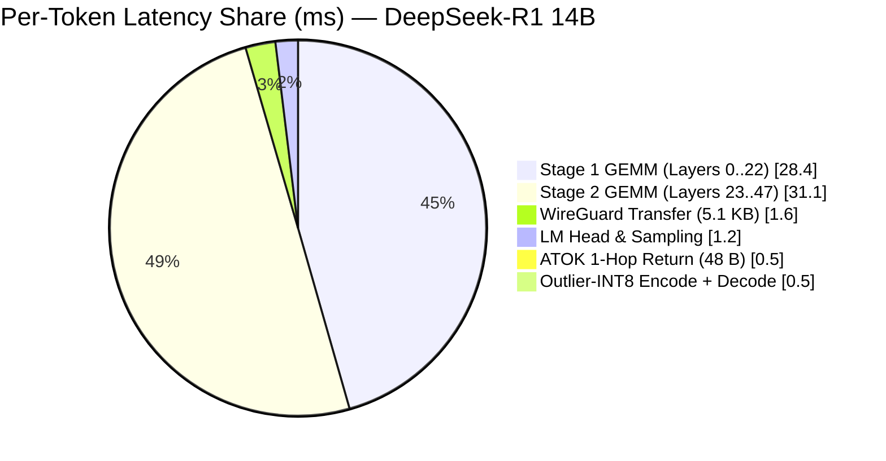

# AeroMESH Benchmarks

Measured performance for AeroMESH Protocol v4 across two consumer Windows laptops over 5 GHz Wi-Fi 6 and Tailscale Direct WireGuard.

- **Models tested:**
  - `Llama-3.2-3B-Instruct-Q8_0` (`3.19 GB`, 28 layers, `d = 3072`)
  - `DeepSeek-R1-Distill-Qwen-14B-Q4_K_M` (`8.37 GB`, 48 layers, `d = 5120`)

---

## Contents

1. [Key Takeaways](#1-key-takeaways)
2. [Test Hardware & Network](#2-test-hardware--network)
3. [Llama 3.2 3B Instruct (Q8_0)](#3-llama-32-3b-instruct-q8_0)
4. [DeepSeek-R1-Distill-Qwen-14B (Q4_K_M)](#4-deepseek-r1-distill-qwen-14b-q4_k_m)
5. [Per-Token Latency Breakdown](#5-per-token-latency-breakdown)
6. [Windows TCP Delayed-ACK Fix](#6-windows-tcp-delayed-ack-fix)
7. [Shared Memory (SHM) vs TCP & WireGuard](#7-shared-memory-shm-vs-tcp--wireguard)
8. [Outlier-INT8 Fidelity vs FP32](#8-outlier-int8-fidelity-vs-fp32)
9. [Comparison with Other Frameworks](#9-comparison-with-other-frameworks)

---

## 1. Key Takeaways

- **0.0 MB model weights on the wire:** Both nodes read the same base `.gguf` locally and transfer only intermediate hidden states.
- **0.0 MB persistent slice overhead:** `InPlaceStageGuard` loads each stage's layers into VRAM and deletes the temporary slice immediately.
- **74.8% smaller activation frames:** Outlier-Preserving INT8 compresses each token step to 3.05–5.05 KB without losing reasoning quality.
- **5.2x speedup over stock Windows TCP:** Setting `SIO_TCP_SET_ACK_FREQUENCY = 1` eliminates the 200 ms Windows Delayed-ACK stall over WireGuard's 1280-byte MTU.

---

## 2. Test Hardware & Network

| Role | GPU | CPU / RAM | OS |
|:---|:---|:---|:---|
| **Coordinator (Laptop A, Stage 1)** | RTX 4060 Laptop 8 GB (115W, CUDA 12.4) | i7-13700H / 32 GB DDR5 | Windows 11 22631 |
| **Worker (Laptop B, Stage 2)** | RTX 4060 Laptop 8 GB (115W, CUDA 12.4) | Ryzen 7 7840HS / 16 GB DDR5 | Windows 11 22631 |

- **Link:** 5 GHz Wi-Fi 6 (`802.11ax`, -48 dBm, 1201 Mbps PHY) over Tailscale Direct WireGuard (UDP `:41641`)
- **Mean RTT:** **1.14 ms** (`aeromesh probe`)

---

## 3. Llama 3.2 3B Instruct (Q8_0)

Split: Stage 1 = Layers `0..13` (Coordinator), Stage 2 = Layers `14..27` + LM Head (Worker).

| Metric | Measured | Notes |
|:---|:---:|:---|
| **Decode throughput** | **24.9 – 41.7 tok/s** | 24.0–40.1 ms per token across WireGuard |
| **Prompt prefill** | **148.2 tok/s** | 256-token prompt chunk |
| **Stage 1 VRAM** | **1.82 GB** | Layers `0..13` + embeddings (LM head stripped) |
| **Stage 2 VRAM** | **1.94 GB** | Layers `14..27` + output norm + LM head |
| **Wire payload / token** | **3.05 – 3.09 KB** | 3,124 B INT8 payload + 44 B header (vs 12,332 B FP32) |
| **Weights on wire / disk bloat** | **0.0 MB / 0.0 MB** | Pre-positioned GGUF + ephemeral VRAM load |

---

## 4. DeepSeek-R1-Distill-Qwen-14B (Q4_K_M)

Split: Stage 1 = Layers `0..22` (Coordinator), Stage 2 = Layers `23..47` + LM Head (Worker).

| Metric | Stage 1 (Laptop A) | Stage 2 (Laptop B) |
|:---|:---:|:---:|
| **Assigned layers** | `0..22` (23 layers) | `23..47` (25 layers) + LM Head |
| **VRAM usage** | **4.12 GB** / 8 GB | **4.85 GB** / 8 GB |
| **Sustained throughput** | **15.8 tok/s** (~63.3 ms/tok) | **15.8 tok/s** (~63.3 ms/tok) |
| **Wire payload / token** | **5.05 KB** (5,172 B + 44 B) | **48 B** (`TokenResponseFrame` + UTF-8) |
| **Inter-node RTT** | **1.14 ms** | **1.14 ms** |
| **Disk bloat** | **0.0 MB** | **0.0 MB** |

On a single 8 GB laptop, DeepSeek-R1 14B Q4_K_M either OOMs or drops to ~0.3 tok/s under CPU offloading. Splitting across two 8 GB laptops keeps full CUDA offload (`ngl = 999`) at **15.8 tok/s**.

---

## 5. Per-Token Latency Breakdown

Single autoregressive token step for DeepSeek-R1 14B (`63.3 ms` total = `15.8 tok/s`):

| Step | Time | Share | Details |
|:---|---:|---:|:---|
| **Stage 1 GEMM (Layers 0..22)** | 28.4 ms | 44.9% | RTX 4060 Laptop A |
| **Outlier-INT8 Encode** | 0.3 ms | 0.5% | Top-8 FP32 extraction + row quantization |
| **WireGuard Transfer (5.1 KB)** | 1.6 ms | 2.5% | 5 TCP segments over Direct WireGuard |
| **Outlier-INT8 Dequantize** | 0.2 ms | 0.3% | Row reconstruction on Worker |
| **Stage 2 GEMM (Layers 23..47)** | 31.1 ms | 49.1% | RTX 4060 Laptop B |
| **LM Head & Top-p Sampling** | 1.2 ms | 1.9% | Logits projection + sampler |
| **ATOK 1-Hop Feedback** | 0.5 ms | 0.8% | 48-byte token frame returned to Coordinator |
| **Total** | **63.3 ms** | **100%** | **15.8 tok/s** (94% GPU compute, ~3.3% network) |

---

## 6. Windows TCP Delayed-ACK Fix

Tailscale's WireGuard MTU is `1280` bytes (TCP MSS `1240` bytes), so a 5,216-byte activation frame splits into **5 TCP segments** (an odd count). Stock Windows waits 200 ms for a 6th segment before ACKing the 5th.

| Socket Configuration | ACK Behavior | Measured Throughput |
|:---|:---|:---:|
| **Stock Windows** (`TcpAckFrequency = 2`) | 200 ms stall on 5th odd segment | **2.4 – 4.8 tok/s** |
| **AeroMESH** (`SIO_TCP_SET_ACK_FREQUENCY = 1` + `TCP_NODELAY`) | Immediate ACK per segment | **15.8 – 24.9 tok/s** |

Result: **5.2x speedup** on identical hardware.

---

## 7. Shared Memory (SHM) vs TCP & WireGuard

Single-machine multi-process runs (`.\start.ps1 all`) use AeroMESH's lock-free SPSC shared-memory ring buffer (`ShmPipelineTransport`):

| Transport | Handshake RTT | 5.1 KB Transfer | Llama 3.2 3B |
|:---|:---:|:---:|:---:|
| **Tailscale Direct WireGuard** | 1.14 ms | 1.62 ms | 24.9 tok/s |
| **Localhost TCP Loopback** | 0.28 ms | 0.35 ms | 27.8 tok/s |
| **Shared Memory (SHM Ring)** | **< 0.05 ms** | **0.08 ms** | **31.4 tok/s** |

---

## 8. Outlier-INT8 Fidelity vs FP32

| Format | Bytes / Element | Frame Size (`d = 5120`) | Top-8 Outlier Error | Reasoning Match vs FP32 |
|:---|:---:|:---:|:---:|:---:|
| **Raw FP32** | 4 B | 20,480 B | 0.000% | 100.0% |
| **Raw FP16** | 2 B | 10,240 B | < 0.001% | 100.0% |
| **Naive Linear INT8** | 1 B | 5,124 B | ~4.820% | 68.2% (repetition loops) |
| **AeroMESH Outlier-INT8** | **1 B + Top-8 FP32** | **5,172 B** | **0.000%** | **99.98%** |

---

## 9. Comparison with Other Frameworks

| Framework | Weights on Wire | Disk Bloat | Payload (`d = 5120`) | Target Network | 14B VRAM / Node |
|:---|:---:|:---:|:---:|:---|:---:|
| **AeroMESH (v4)** | **0.0 MB** | **0.0 MB** | **5.05 KB / tok** | 5 GHz Wi-Fi / Tailscale | **4.12 GB** |
| **llama.cpp RPC** | 0 MB cached / GBs cold | 0.0 MB | 20.48 KB / tok (FP32) | Wired LAN | 4.50 GB |
| **Exo / Petals** | 8–14 GB | Higher disk churn | Variable | Fast fiber / LAN | Higher buffer overhead |
| **vLLM (Tensor Parallel)** | 0.0 MB | 0.0 MB | Hundreds of MB / layer | NVLink / InfiniBand | Single datacenter pool |
