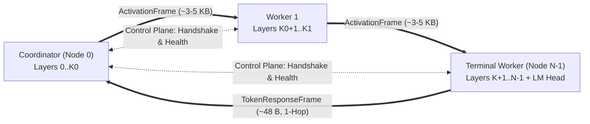

# Contributing to AeroMESH

Contributions are welcome across the Rust inference engine, wire protocol, Python gateway, Windows installer, tests, and frontend UI. All contributions are licensed under the [Apache License 2.0](LICENSE).

---

## Contents

1. [Architecture & Protocol v4 Invariants](#1-architecture--protocol-v4-invariants)
2. [Development Setup (Windows)](#2-development-setup-windows)
3. [Building from Source & Installer Packaging](#3-building-from-source--installer-packaging)
4. [Running the Test Suite (93 Tests)](#4-running-the-test-suite-93-tests)
5. [Local Mesh Testing](#5-local-mesh-testing)
6. [Code Style & PR Checklist](#6-code-style--pr-checklist)

---

## 1. Architecture & Protocol v4 Invariants



When modifying `aeromesh-core` or `aeromesh-engine`, preserve these invariants:

1. **Zero network weight transfers:** Model weights stay local on each node; temporary stage slices load into VRAM via `InPlaceStageGuard` and are immediately deleted.
2. **Identity RMSNorm on non-terminal stages:** Stages `0..N-2` replace `output_norm.weight` with `[1.0, ..., 1.0]` so the residual stream is not double-normalized. Only the terminal stage applies the real `output_norm.weight` and LM head.
3. **RoPE position coherence:** Every stage must propagate `ActivationHeader.token_position` and assign `batch.pos[i] = token_position + i`.
4. **1-hop token return:** The terminal stage streams `TokenResponseFrame` directly back to Node 0 rather than chaining backwards through intermediate hops.
5. **No duplicate BOS tokens:** Do not prepend another BOS token if the prompt already begins with special markers.
6. **KV-cache sync:** Workers must immediately flush their local KV cache when `FLAG_CLEAR_KV (0x01)` is set in `ActivationHeader.flags`.
7. **32-byte tensor alignment:** Sliced GGUF outputs in `gguf_slicer` must keep every tensor aligned to 32 bytes.

---

## 2. Development Setup (Windows)

### Prerequisites
- **Rust 1.78+** (MSVC `x86_64-pc-windows-msvc` recommended; `llama_ffi.rs` resolves `llama.dll` symbols dynamically via `LoadLibrary`/`GetProcAddress`, so MinGW `dlltool.exe` is no longer required).
- **Python 3.11+** (3.12 recommended).
- **Native `llama.cpp` DLLs** in `bin/` (`llama.dll`, `ggml.dll`, `ggml-cuda.dll`, `ggml-base.dll`, `ggml-cpu.dll`).
- **Tailscale** (optional, for multi-machine testing over WireGuard).
- **Inno Setup 6** (optional, only needed to build `AeroMesh-Setup-x64.exe`).

### Bootstrap
```powershell
# Prepare runtime DLLs, Python venv, and .env (add -CloneLlamaCpp to build llama.cpp from source)
.\setup.ps1
```

Or install Python dev dependencies manually:
```powershell
python -m venv .venv
.\.venv\Scripts\Activate.ps1
pip install -e ".[dev]"
```

---

## 3. Building from Source & Installer Packaging

### Rust Workspace
```powershell
cargo build --release --workspace
Copy-Item -Path "bin\*.dll" -Destination "target\release" -Force
```

### Windows Setup Wizard (`AeroMesh-Setup-x64.exe`)
```powershell
# Stages Rust binaries, CUDA/CPU DLLs, standalone Python embeddable runtime, and compiles the Inno Setup wizard
.\installer\build-installer.ps1
```

---

## 4. Running the Test Suite (93 Tests)

AeroMESH has **66 Rust tests** (`20` in `aeromesh-core` + `46` in `aeromesh-engine`) and **27 Python pytest cases** (`tests/test_fastapi_gateway.py`):

```powershell
# 1. Rust workspace tests (66 tests)
cargo test --workspace

# 2. Python FastAPI gateway tests (27 parametrized cases)
# Stop any running local coordinator first so offline-fallback tests run cleanly
Stop-Process -Name "aeromesh" -Force -ErrorAction SilentlyContinue
.\.venv\Scripts\pytest.exe tests/test_fastapi_gateway.py -v
```

### Formatting & Linting
```powershell
cargo fmt --check
cargo clippy --workspace --all-targets -- -D warnings
```

---

## 5. Local Mesh Testing

### Via `start.ps1`
```powershell
# Single-machine local mesh over shared memory (SHM)
.\start.ps1 all -Model "models/test.gguf"

# Two-machine split
.\start.ps1 worker -Port 50052 -Model "models/test.gguf"
.\start.ps1 coordinator -Peers "100.101.147.24:50052" -Model "models/test.gguf"
```

### Direct CLI
```powershell
.\target\release\aeromesh.exe worker --port 50052 --model "models/test.gguf"
.\target\release\aeromesh.exe start --role coordinator --model "models/test.gguf" --port 8080 --peers "127.0.0.1:50052"
```

Open the UI at `http://127.0.0.1:7860`.

---

## 6. Code Style & PR Checklist

- **Rust:** Rust 2021 conventions, `thiserror` in crates, `anyhow` in binaries, no panics in network decoders or streaming loops, unit tests for bounds/overflow checks whenever touching `activation.rs`.
- **Python:** Type annotations on routes/helpers, clean hop-by-hop header stripping, no blocking I/O on the FastAPI event loop.
- **Frontend:** Vanilla JS + CSS (`static/css/liquid_glass.css`), no bundler required; sanitize dynamic HTML with DOMPurify and keep vendor libraries under `static/vendor/`.
- **Before opening a PR:**
  - `cargo test --workspace` and `pytest tests/test_fastapi_gateway.py` pass.
  - `cargo fmt --check` and `cargo clippy --workspace --all-targets -- -D warnings` pass.
  - Update `README.md` or `API_REFERENCE.md` if you add routes, CLI flags, or wire fields.

For security issues, see [SECURITY.md](SECURITY.md) instead of opening a public issue.
