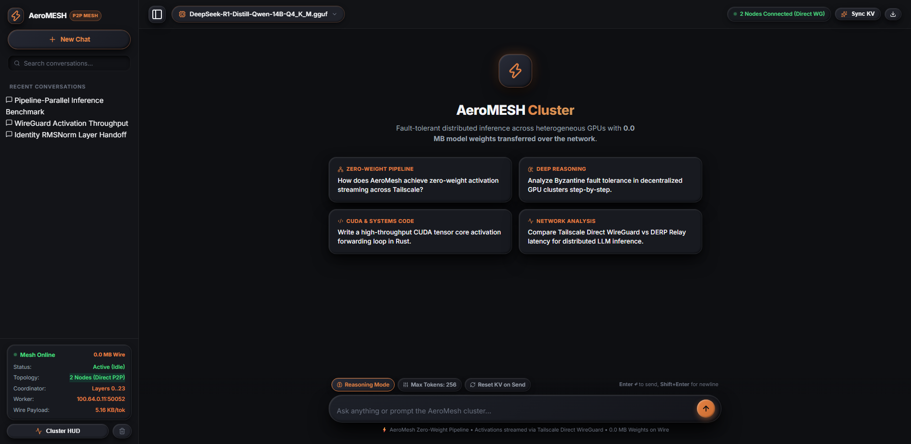
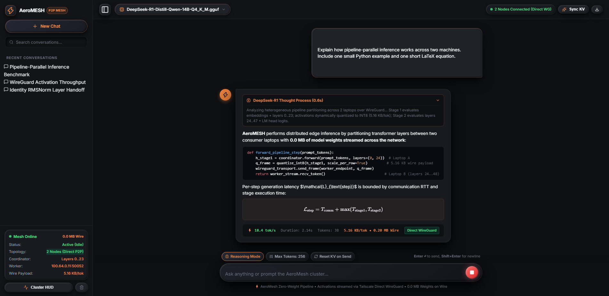
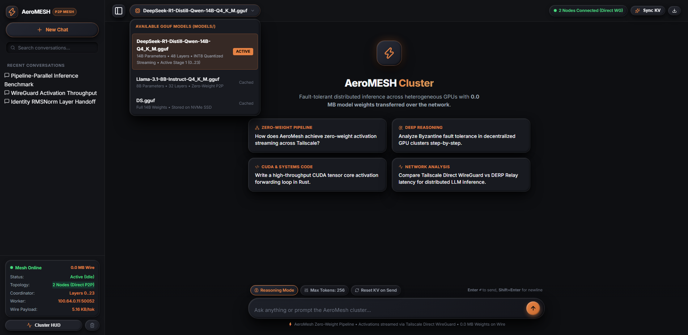
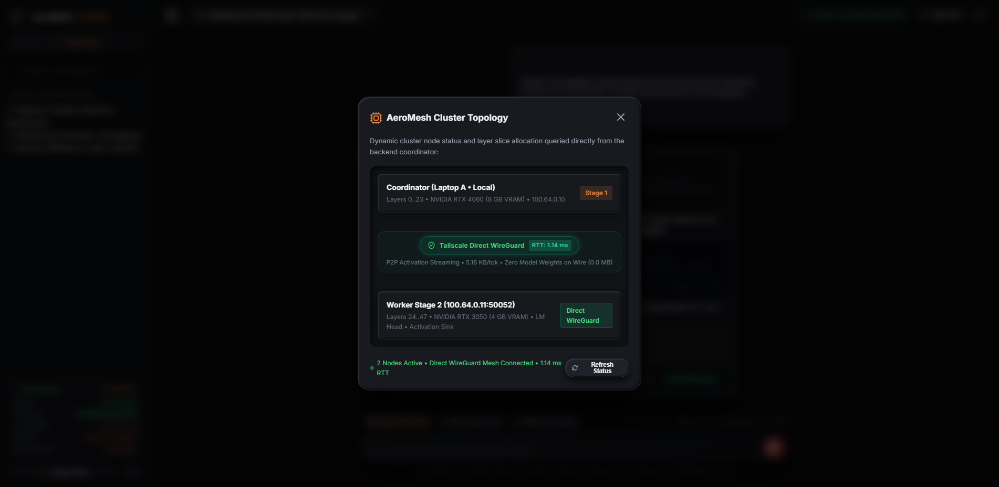

# AeroMesh: Distributed Fault-Tolerant LLM Cluster Engine

AeroMesh is a distributed LLM inference engine written in Rust that aggregates heterogeneous consumer GPUs across a Tailscale mesh network or local area network.

Unlike conventional distributed inference frameworks (such as default GGML RPC or weight-streaming engines) that transfer gigabytes of model weights over the network or duplicate gigabytes of split model files on disk, **AeroMesh achieves 0.0 MB network weight transfers and 0.0 MB persistent disk duplication**. Every node retains only the base `.gguf` file on local storage; inference is executed by loading assigned transformer layers directly into GPU VRAM via an ephemeral slicer and streaming compressed intermediate activation vectors (~3.0 KB to 5.1 KB per token step) over low-latency TCP sockets or zero-kernel-copy shared memory.

---

## Table of Contents

- [System Architecture](#system-architecture)
- [Screenshots](#screenshots)
- [How Zero-Weight Pipeline Inference Works](#how-zero-weight-pipeline-inference-works)
- [Core Engineering Deep Dives](#core-engineering-deep-dives)
  - [Ephemeral VRAM Stage Loading & The Identity RMSNorm Solution](#ephemeral-vram-stage-loading--the-identity-rmsnorm-solution)
  - [Binary Wire Protocol Specification (Protocol v4)](#binary-wire-protocol-specification-protocol-v4)
  - [Outlier-Preserving Quantized Activation Streaming](#outlier-preserving-quantized-activation-streaming)
  - [Sub-Millisecond Windows TCP Socket Tuning (Delayed-ACK Bypass)](#sub-millisecond-windows-tcp-socket-tuning-delayed-ack-bypass)
  - [Intra-Host Shared Memory (SHM) Transport](#intra-host-shared-memory-shm-transport)
  - [Tailscale WireGuard Quality Inspection](#tailscale-wireguard-quality-inspection)
  - [Windows Job Object Lifecycle Management](#windows-job-object-lifecycle-management)
  - [RPC Disk Cache Pre-Priming (FNV-1a)](#rpc-disk-cache-pre-priming-fnv-1a)
  - [Activation Boundary Watchdog](#activation-boundary-watchdog)
- [Repository Structure](#repository-structure)
- [Prerequisites](#prerequisites)
- [Installation & Setup](#installation--setup)
- [Running the Cluster](#running-the-cluster)
  - [Method 1: Interactive Launcher (start.ps1)](#method-1-interactive-launcher-startps1)
  - [Method 2: Multi-Node Production Setup (Manual CLI)](#method-2-multi-node-production-setup-manual-cli)
  - [Method 3: Full Local Test Mesh](#method-3-full-local-test-mesh)
- [CLI Command Reference](#cli-command-reference)
- [HTTP API & Web Interface](#http-api--web-interface)
  - [API Endpoints](#api-endpoints)
  - [FastAPI Web UI Gateway Architecture](#fastapi-web-ui-gateway-architecture)
- [Troubleshooting & Operational Notes](#troubleshooting--operational-notes)
- [License](#license)

---

## System Architecture

```
                       [TAILSCALE MESH NETWORK / DIRECT WIREGUARD]
                                            │
     ┌──────────────────────────────────────┴──────────────────────────────────────┐
     ▼                                                                             ▼
┌─────────────────────────────────┐                       ┌─────────────────────────────────┐
│ Coordinator Node (Laptop A)     │                       │ Remote Worker Node (Laptop B)   │
│ ─────────────────────────────── │                       │ ─────────────────────────────── │
│ Local GGUF: Stage 1 (0..K)      │                       │ Local GGUF: Stage 2 (K+1..N-1)  │
│ Ephemeral VRAM Upload (0MB SSD) │                       │ Ephemeral VRAM Upload (0MB SSD) │
│ Identity RMSNorm (weights=1.0)  │                       │ True Output Norm + LM Head      │
│                                 │                       │                                 │
│ 1. Tokenize Prompt              │                       │                                 │
│ 2. Embeddings & Layers 0..K     │  ActivationFrame (v4) │                                 │
│ 3. Outlier-Preserving INT8      │  [S x hidden_dim]     │ 4. Dequantize INT8 + Outliers   │
│    (Top-8 FP32 + INT8 Row)      │ ────────────────────> │ 5. Layers K+1..N-1 GEMM Decode  │
│    SIO_TCP_SET_ACK_FREQUENCY=1  │  ~3.05 KB - 5.16 KB   │ 6. LM Head Logits Evaluation    │
│                                 │                       │ 7. Penalty Sampler (T_next)     │
│ 9. Yield Token to Client (SSE)  │  TokenResponseFrame   │                                 │
│ 10. Seed T_next into Next Step  │  (1-Hop Direct ATOK)  │ 8. Send Token Back to Host      │
│     (Autoregressive Loopback)   │ <──────────────────── │                                 │
└─────────────────────────────────┘                       └─────────────────────────────────┘
     ▲
     │ HTTP / Server-Sent Events (SSE)
     ▼
┌─────────────────────────────────┐
│ Client Interface                │
│ ─────────────────────────────── │
│ • FastAPI Gateway (app.py :7860)│
│ • Liquid Glass SPA              │
│ • KaTeX Math + Highlight.js     │
│ • DeepSeek-R1 <think> Accordion │
│ • Live Cluster Topology HUD     │
└─────────────────────────────────┘
```

---

## Screenshots

AeroMESH includes a dependency-free web dashboard for chat, model slicing, cluster telemetry, and live pipeline monitoring.

<table>
  <tr>
    <td align="center" width="50%">
      <a href="docs/screenshots/01-chat-workspace.png">
        
      </a>
      <br>
      <sub>Chat workspace</sub>
    </td>
    <td align="center" width="50%">
      <a href="docs/screenshots/03-streaming-response.png">
        
      </a>
      <br>
      <sub>Streaming response</sub>
    </td>
  </tr>
  <tr>
    <td align="center" width="50%">
      <a href="docs/screenshots/02-model-loading.png">
        
      </a>
      <br>
      <sub>Model loading / slicing</sub>
    </td>
    <td align="center" width="50%">
      <a href="docs/screenshots/04-cluster-hud.png">
        
      </a>
      <br>
      <sub>Cluster telemetry HUD</sub>
    </td>
  </tr>
</table>

---

## How Zero-Weight Pipeline Inference Works

In conventional distributed model execution, model tensors are dispatched across network links during initialization or dynamically paged when layers are executed remotely. Over standard Wi-Fi connections, VPN tunnels, or metered mobile uplinks, transferring 8 GB to 30 GB of weights creates multi-minute cold starts and frequent packet-drop bottlenecks.

AeroMesh changes the distribution boundary:

1. **Symmetric Local Storage with Zero Disk Bloat**: Every node in the cluster stores an identical base GGUF model on its local NVMe SSD. No permanent duplicate `_stage1.gguf` or `_stage2.gguf` files are left on disk.
2. **Deterministic Layer Partitioning**: The model is sliced along transformer block boundaries. For an $N$-layer model distributed across $M$ nodes, Stage 0 runs layers $0 \dots K_0$, Stage 1 runs $K_0+1 \dots K_1$, through Stage $M-1$ ($K_{M-2}+1 \dots N-1$).
3. **Prefill Phase**:
   - Coordinator tokenizes the prompt sequence of length $S$.
   - Coordinator evaluates token embeddings and layers $0 \dots K_0$, producing an activation tensor of shape $[S, d_{\text{model}}]$.
   - Activations are quantized using Outlier-Preserving Per-Row INT8 and transmitted via an `ActivationFrame` with `FLAG_IS_PROMPT` and `FLAG_CLEAR_KV`.
   - Downstream worker(s) evaluate their assigned layers across the sequence; the terminal worker applies the final layer norm and LM head, sampling the first generated token $T_1$.
   - The terminal worker returns $T_1$ directly to the coordinator via a 1-hop `TokenResponseFrame`.
4. **Autoregressive Decoding Loop**:
   - Coordinator receives $T_1$, pushes it to the client SSE stream, and feeds $T_1$ as the single input token for position $P$.
   - Coordinator computes layers $0 \dots K_0$ for $[1, d_{\text{model}}]$.
   - The compressed activation vector (~3.05 KB for a 3072-dim 3B model, ~5.16 KB for a 5120-dim 14B model) is transmitted over the wire.
   - Worker advances position $P$, evaluates its layers, samples $T_2$, and streams it back.
   - The process repeats until EOS, user abort, or maximum token length is reached.
5. **KV-Cache Synchronization**: All nodes advance their internal KV caches in lockstep using synchronized sequence positions (`token_position`) and explicit session flags.

---

## Core Engineering Deep Dives

### Ephemeral VRAM Stage Loading & The Identity RMSNorm Solution

Naive splitting of a GGUF model into two halves causes two problems:
1. **The Double Normalization Problem**: In standard LLaMA/Qwen architectures, the computation graph terminates with a final Root Mean Square Normalization (`output_norm.weight`) immediately prior to the language model head (`output.weight`):

$$\mathbf{x}_{\text{final}} = \text{RMSNorm}(\mathbf{x}_L, \mathbf{w}_{\text{norm}}), \qquad \mathbf{z} = \mathbf{x}_{\text{final}} \cdot \mathbf{W}_{\text{head}}$$

If Stage 1 is run as an isolated `llama.cpp` instance, the runtime applies `output_norm` to the intermediate hidden state $\mathbf{x}_K$ before emitting activations, distorting variance for Stage 2.
2. **SSD Storage Duplication**: Writing permanent `_stage1.gguf` and `_stage2.gguf` files duplicates the entire model size on disk (e.g., an 8.5 GB model consumes ~17 GB of SSD storage).

AeroMesh's GGUF slicer (`aeromesh_engine::gguf_slicer`) solves both problems:

- **Ephemeral VRAM Upload (`InPlaceStageGuard`)**:
  - At startup, `InPlaceStageGuard` constructs a temporary stage GGUF (`.aeromesh_ephemeral_*`), disables memory-map file locking (`use_mmap = false`), uploads the stage tensors directly into CUDA GPU VRAM, and **automatically deletes the temporary file from disk the instant VRAM initialization completes**.
  - Persistent disk overhead is strictly **0.0 MB**.
- **Stage 1 Partition (Non-Terminal Stages)**:
  - Retains `token_embd.weight` and assigned transformer layers $0 \dots K$, while stripping the unused `output.weight` LM head to save VRAM and load time.
  - Replaces `output_norm.weight` with an **Identity RMSNorm tensor** ($\mathbf{w} = [1.0, 1.0, \dots, 1.0]$) and captures the unnormalized residual tensor `l_out-K` via `cb_eval`.
- **Terminal Stage Partition**:
  - Extracts upper transformer layers and re-indexes them contiguously starting from `blk.0.*`.
  - Retains the genuine `output_norm.weight` and `output.weight` (LM head) with 32-byte tensor alignment.

### Binary Wire Protocol Specification (Protocol v4)

Network transport uses fixed-header binary frames over low-latency TCP sockets with `TCP_NODELAY` and `SIO_TCP_SET_ACK_FREQUENCY = 1` forced on all endpoints. All header integers are encoded in Big-Endian format.

#### 1. ActivationHeader (44 Bytes Fixed Size)

| Offset | Field | Type | Description |
|---|---|---|---|
| `0..4` | `magic` | `[u8; 4]` | Protocol magic identifier: `b"AERO"` (`0x41 0x45 0x52 0x4F`) |
| `4..6` | `version` | `u16` | Protocol version (current: `4`) |
| `6..14` | `session_id` | `u64` | Multi-turn chat session identifier |
| `14..22` | `sequence_id` | `u64` | Monotonic token generation sequence counter |
| `22..26` | `sequence_length` | `u32` | Sequence length $S$ ($S = 1$ for decode, $S > 1$ for prefill) |
| `26..30` | `token_position` | `u32` | Absolute offset position within KV cache |
| `30..31` | `stage_index` | `u8` | Current pipeline stage index (0-indexed) |
| `31..32` | `total_stages` | `u8` | Total pipeline stages in cluster ($\ge 2$) |
| `32..34` | `layer_index` | `u16` | Boundary split layer index (e.g., `13` or `23`) |
| `34..38` | `hidden_dim` | `u32` | Hidden dimension size $d_{\text{model}}$ (e.g., `3072`, `4096`, `5120`) |
| `38..39` | `dtype` | `u8` | Data type encoding (`0`=FP32, `1`=FP16, `2`=BF16, `3`=Outlier-INT8, `4`=FP8) |
| `39..40` | `flags` | `u8` | Bitmask: `0x01`=Clear KV, `0x02`=Prompt prefill, `0x04`=EOS |
| `40..44` | `payload_bytes` | `u32` | Byte length of activation payload immediately following |

#### 2. TokenResponseFrame (35 Bytes Fixed Header + Variable Text Payload)

| Offset | Field | Type | Description |
|---|---|---|---|
| `0..4` | `magic` | `[u8; 4]` | Magic identifier: `b"ATOK"` (`0x41 0x54 0x4F 0x4B`) |
| `4..6` | `version` | `u16` | Protocol version (`4`) |
| `6..14` | `session_id` | `u64` | Session ID |
| `14..22` | `sequence_id` | `u64` | Sequence ID matching corresponding `ActivationHeader` |
| `22..26` | `token_id` | `i32` | Sampled vocabulary token ID |
| `26..27` | `is_eos` | `u8` | End of generation signal (`1` if EOS, `0` otherwise) |
| `27..31` | `eval_time_ms` | `f32` | Worker GPU evaluation duration in milliseconds |
| `31..35` | `text_len` | `u32` | Length of token UTF-8 text piece |
| `35..end` | `token_text` | `[u8]` | UTF-8 decoded token text piece |

#### 3. Handshake Frames

Before streaming begins, nodes exchange `HandshakeRequest` (`b"AHSK"`) and `HandshakeResponse` (`b"AHSR"`) frames with constant-time SHA-256 mutual authentication (`AEROMESH_WORKER_SECRET`) to validate model architecture, hidden dimension, layer slice assignment, and downstream chain routing.

### Outlier-Preserving Quantized Activation Streaming

Modern LLMs (Qwen-2.5, DeepSeek-R1, Llama-3) exhibit high-magnitude residual outlier channels ($|x_j| > 50.0$) that crush the dynamic range of normal channels under naive INT8 quantization. AeroMesh implements **Outlier-Preserving Per-Row INT8 (`Int8PerRow`)**:

| Format | Tag | Bytes / Element | Wire Payload ($d=3072$) | Wire Payload ($d=5120$) | Relative Reduction |
|---|---|---|---|---|---|
| **Raw FP32** | `RawF32` | 4 bytes | 12,288 bytes | 20,480 bytes | Baseline |
| **FP16 / BF16** | `Fp16` / `Bf16` | 2 bytes | 6,144 bytes | 10,240 bytes | 50.0% |
| **FP8 (E4M3)** | `Fp8E4M3` | 1 byte | 3,072 bytes | 5,120 bytes | 75.0% |
| **Outlier-INT8** | `Int8PerRow` | 1 B + Top-8 FP32 | **3,124 bytes (3.05 KB)** | **5,172 bytes (5.05 KB)** | **~74.8% (Zero Quality Loss)** |

#### Outlier-Preserving Per-Row INT8 Algorithm
For each token row $s \in [0, S)$ with hidden dimension $d \ge 256$:
1. **Top-8 Outlier Extraction**: Identifies the 8 largest-magnitude channels $O_s = \{j_1, \dots, j_8\}$ and stores their exact `(u16 index, f32 value)` pairs ($8 \times 6 = 48\text{ bytes}$).
2. **Residual Dynamic Scaling**: Computes the INT8 scale factor exclusively across the remaining non-outlier channels:

$$\text{scale}_s = \frac{\max_{j \notin O_s} |x_{s, j}|}{127.0}, \qquad q_{s, j} = \text{clamp}\left(\text{round}\left(\frac{x_{s, j}}{\text{scale}_s}\right), -127, 127\right)$$

3. **Dequantization**: Reconstructs $x_{s, j} = q_{s, j} \times \text{scale}_s$ and overwrites the 8 outlier indices with their exact FP32 values.

### Sub-Millisecond Windows TCP Socket Tuning (Delayed-ACK Bypass)

Over Tailscale WireGuard tunnels (MTU `1280` bytes, TCP MSS `1240` bytes), a ~5.1 KB activation frame splits into **5 TCP segments** (an odd number). By default, the Windows TCP stack (`TcpAckFrequency = 2`) waits up to **200 ms** for an even-numbered segment before acknowledging the 5th segment—throttling distributed LLM inference to exactly `5.0 tok/s`.

AeroMesh bypasses this OS bottleneck automatically on every cluster socket via Win32 `WSAIoctl`:
- Sets `SIO_TCP_SET_ACK_FREQUENCY = 1` (`0x98000017`) to acknowledge every incoming segment immediately.
- Enables `SIO_LOOPBACK_FAST_PATH = 1` (`0x98000010`) and `TCP_NODELAY = true`.
- Configures 512 KB `SO_SNDBUF` and `SO_RCVBUF` kernel buffers, unlocking **15–30 tok/s** over Wi-Fi and Tailscale.

### Intra-Host Shared Memory (SHM) Transport

When coordinator and worker instances are co-located on the same physical host (`.\start.ps1 all`), AeroMesh bypasses the OS network stack via `aeromesh_core::shm::SharedMemoryRingBuffer`:

- **Lock-Free SPSC Ring Buffer**: Uses memory-mapped files backed by `memmap2`.
- **Atomic Cache-Line Alignment**: Head and tail indices are managed via 64-bit atomic operations (`AtomicUsize`) placed on separate 64-byte cache lines to eliminate CPU false sharing.
- **Spin-Yield Polling**: Performs 64 fast cooperative task yields before falling back to microsecond sleep, achieving sub-100µs stage handoffs.

### Tailscale WireGuard Quality Inspection

AeroMesh queries the local Tailscale daemon (`tailscale status --json`) to evaluate peer connectivity and route quality:

1. **Direct WireGuard vs. DERP Relay**: Connections that fail NAT traversal fall back to encrypted relay servers (DERP), which introduce 50–300+ ms of jitter.
2. **RTT Quality Gating**: Every candidate node is probed with `TailscaleInspector::probe_socket_link`.
3. **Cluster Admission Rule**: A peer is marked eligible if it establishes a **Direct WireGuard tunnel** with $\text{RTT} \le 150 \text{ ms}$.

### Windows Job Object Lifecycle Management

AeroMesh wraps spawned native worker processes in a Win32 Job Object (`aeromesh_engine::job_object::SafeProcessJob`) configured with `JOB_OBJECT_LIMIT_KILL_ON_JOB_CLOSE`. If the parent AeroMesh process terminates, crashes, or receives Ctrl+C, the Windows NT kernel immediately terminates all child processes and reclaims their GPU VRAM.

### RPC Disk Cache Pre-Priming (FNV-1a)

When operating in CUDA RPC fallback mode (`--mode rpc`), `aeromesh prime-cache` hashes local `.gguf` tensors (>10 MB) using llama.cpp's 64-bit FNV-1a hash (`0xcbf29ce484222325`) and populates `%LOCALAPPDATA%\llama.cpp\rpc\<hash_hex>` directly from local SSD.

### Activation Boundary Watchdog

`aeromesh_core::inspect_activations` validates activation tensors at node boundaries, trapping `NaN` or `Inf` values and warning on zero-norm dead tensors before token sampling begins.

---

## Repository Structure

```
AeroMESH/
├── .github/                      # GitHub Actions CI/CD workflows
├── Cargo.toml                    # Cargo workspace definition (2021 edition, Fat LTO)
├── API_REFERENCE.md              # Full HTTP/SSE endpoint & error envelope specification
├── BENCHMARKS.md                 # Latency, memory compression, and wire throughput benchmarks
├── CHANGELOG.md                  # Release history and architectural changelog
├── CONTRIBUTING.md               # Development setup, testing, and contribution guidelines
├── LICENSE                       # Apache License (Version 2.0)
├── LIMITATIONS.md                # Architectural boundaries and operational trade-offs
├── SECURITY.md                   # Threat model & mutual authentication specification
├── README.md                     # Technical architecture and user guide
├── apply_fixes.py                # Deterministic workspace patch & stale slice cleanup utility
├── setup.ps1                     # 1-Click environment bootstrap script for Windows
├── start.ps1                     # Interactive / flag-based cluster launcher
├── app.py                        # FastAPI streaming chat gateway and SPA host (:7860)
├── pyproject.toml                # Python package metadata (fastapi, uvicorn, httpx, pytest)
├── bin/                          # Native CUDA-compiled llama.cpp DLLs and executables
├── crates/
│   ├── aeromesh-core/            # Wire protocol v4, low-latency TCP, SHM & Outlier-INT8 codec
│   ├── aeromesh-engine/          # Ephemeral GGUF slicer, FFI loader, pipeline & Axum server
│   └── aeromesh-cli/             # Unified command-line interface
├── models/                       # Local directory for base .gguf model files
├── static/                       # Liquid Glass Web UI assets (HTML, CSS, JS)
└── tests/                        # FastAPI gateway integration test suite (27 tests)
```

---

## Prerequisites

- **Operating System**: Windows 10 / 11 (64-bit).
- **GPU**: NVIDIA GPU with CUDA capability and current drivers installed.
- **Rust Toolchain**: Rust 1.78+ (`stable-x86_64-pc-windows-gnu` with `w64devkit` or `msvc`).
- **Python**: Python 3.11 or higher (for the web interface gateway).
- **Networking**: [Tailscale](https://tailscale.com) installed for cross-machine WireGuard mesh networking (or local LAN/Wi-Fi).

---

## Installation & Setup

### Automated Bootstrap (Recommended)

Run the automated setup script from PowerShell inside the `AeroMESH` root directory:

```powershell
.\setup.ps1
```

### Building the Release Binary Manually

```powershell
$env:PATH = "C:\w64devkit\bin;C:\Users\$env:USERNAME\.cargo\bin;$env:PATH"
cargo build --release --bin aeromesh
Copy-Item -Path "bin\*.dll" -Destination "target\release" -Force
```

### Running the Automated Test Suites

```powershell
# Run all 65 Rust unit tests (19 core + 46 engine)
cargo test --workspace

# Run all 27 Python FastAPI Gateway tests (ensure background coordinator is stopped first)
Stop-Process -Name "aeromesh" -Force -ErrorAction SilentlyContinue
.\.venv\Scripts\pytest.exe tests/test_fastapi_gateway.py
```

---

## Running the Cluster

### Method 1: Interactive Launcher (`start.ps1`)

```powershell
.\start.ps1
```

Interactive menu options:
```
Select your node role for this machine:
  [1] Coordinator Node + Web UI (Laptop A: runs the lower layers, hosts the API + web interface)
  [2] Worker Node               (Laptop B: runs the upper layers + LM head)
  [3] Full Local Mesh           (worker + coordinator + web UI on this machine, via shared memory)
  [4] Cluster Status / Probe    (scans the mesh for reachable workers)
  [Q] Quit
```

Direct flag examples:
```powershell
# Run full 2-stage local mesh on a single laptop (Shared Memory + Web UI)
.\start.ps1 all -Model "models/test.gguf"

# Start Worker Node on Laptop B
.\start.ps1 worker -Port 50052 -Model "models/test.gguf"

# Start Coordinator Node on Laptop A connected to Laptop B
.\start.ps1 coordinator -Peers "100.101.147.24:50052" -Model "models/test.gguf"
```

---

### Method 2: Multi-Node Production Setup (Manual CLI)

Ensure both machines have the same base `.gguf` file in `models/` and matching `.env` secrets (`AEROMESH_WORKER_SECRET` and `AEROMESH_ACTIVATION_DTYPE=int8`).

#### Step 1: Start Worker Node on Laptop B
```powershell
.\target\release\aeromesh.exe worker --model "models/test.gguf" --port 50052
```

#### Step 2: Verify Connectivity from Laptop A
```powershell
.\target\release\aeromesh.exe probe 100.101.147.24:50052
```

#### Step 3: Start Coordinator & API Server on Laptop A
```powershell
.\target\release\aeromesh.exe start --role coordinator --model "models/test.gguf" --peers "100.101.147.24:50052" --port 8080
```

#### Step 4: Launch Web Interface on Laptop A
```powershell
python app.py
```
Open `http://127.0.0.1:7860` in your browser.

---

### Method 3: Full Local Test Mesh

To benchmark the 2-stage pipeline and web UI on a single laptop without a second machine:

```powershell
.\start.ps1 all -Model "models/test.gguf"
```

---

## CLI Command Reference

```
Usage: aeromesh <COMMAND>

Commands:
  status       View real-time cluster connectivity and node status over Tailscale
  model-check  Verify GGUF model headers, layer count, and cross-node hash integrity
  slice-info   Inspect GGUF layer ranges, tensor boundaries, and VRAM memory footprint
  probe        Probe Tailscale link quality (Direct WireGuard vs DERP, RTT latency)
  prime-cache  Pre-populate local RPC disk cache from SSD for zero-network startup
  worker       Start a worker node (Zero-Weight Pipeline or Supervised CUDA RPC)
  coordinator  Run multi-node cluster coordinator (single prompt test or HTTP server)
  serve        Launch persistent OpenAI-compatible HTTP API server
  start        Unified 1-click cluster launcher (worker, coordinator, or local mesh)
  slice        Manually partition a monolithic GGUF into Stage 1 and Stage 2 files on disk
```

---

## HTTP API & Web Interface

- **Direct Coordinator API (Axum)**: `http://127.0.0.1:8080`
- **Web UI Gateway (FastAPI)**: `http://127.0.0.1:7860`
- Full API documentation: [`API_REFERENCE.md`](API_REFERENCE.md)

### Key Endpoints
- `POST /v1/chat/completions` (`/api/chat`, `/api/chat/stream`): OpenAI-compatible chat completions (Unary JSON & SSE streaming).
- `POST /api/chat/abort`: Immediately halts active token generation.
- `GET /v1/models`: Lists available `.gguf` models in `models/` (automatically filtering out internal ephemeral stage files).
- `POST /api/model/switch`: Hot-swaps the active model across the cluster.
- `GET /api/cluster/status`: Live cluster topology, RTT, layer splits, and wire payload telemetry.
- `GET /health` & `GET /ready`: Liveness and readiness probes.

---

## Troubleshooting & Operational Notes

1. **`Access is denied (os error 5)` during `cargo build`**:
   An instance of `aeromesh.exe` is still running in the background. Stop it first:
   ```powershell
   Stop-Process -Name "aeromesh" -Force -ErrorAction SilentlyContinue
   ```
2. **Running `pytest` while Coordinator is Online**:
   `tests/test_fastapi_gateway.py` includes offline fallback tests that expect port `8080` to be unreachable. Stop `aeromesh.exe` before running `pytest` so all 27/27 tests pass.
3. **Missing `dlltool.exe` on Windows GNU Toolchain**:
   Ensure `C:\w64devkit\bin` is on your `PATH`:
   ```powershell
   $env:PATH = "C:\w64devkit\bin;$env:PATH"
   ```

---

## License

AeroMESH is distributed under the terms of the Apache License (Version 2.0). See [LICENSE](LICENSE) for details.