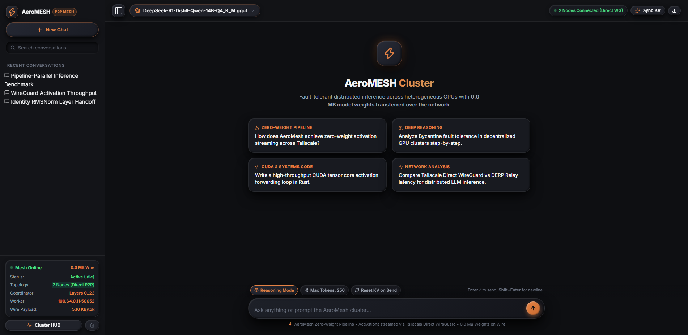
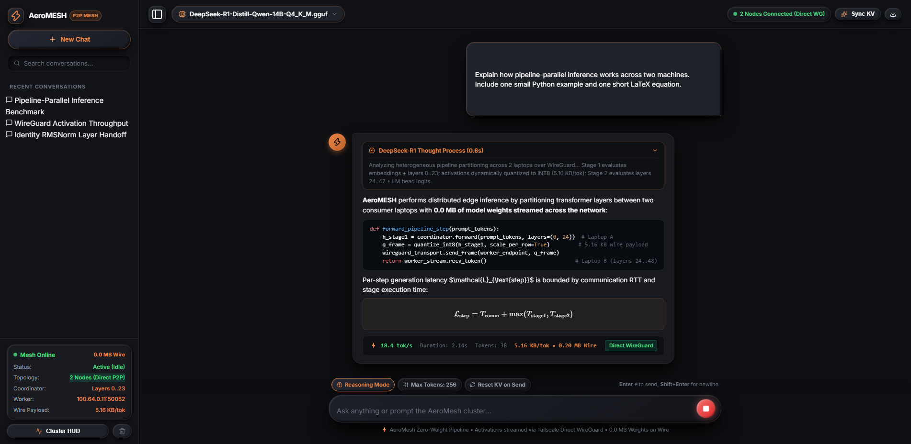
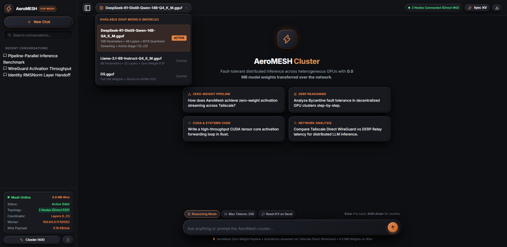
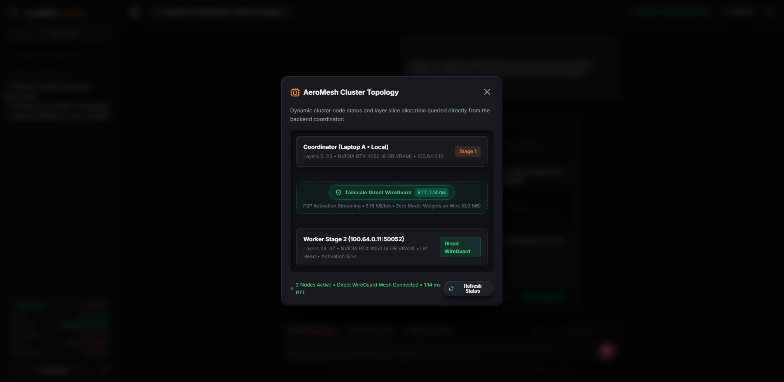
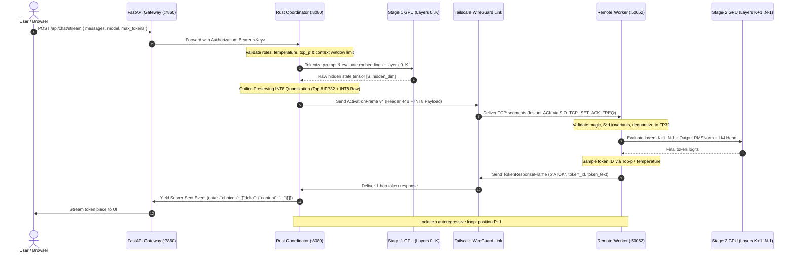

<div align="center">

  

  # AeroMESH
  ### Distributed Fault-Tolerant LLM & Diffusion Cluster Engine for Consumer GPUs
  **Zero-Weight Layer-Pipelined Distributed Inference over Tailscale WireGuard & LAN**

  <p align="center">
    <a href="https://github.com/your-org/AeroMESH/actions"></a>
    <a href="LICENSE"></a>
    <a href="https://www.rust-lang.org/"></a>
    <a href="https://tailscale.com/"></a>
    <a href="https://developer.nvidia.com/cuda-toolkit"></a>
  </p>

  <p align="center">
    
    
    
    
    
    
  </p>

  <p align="center">
    <b>AeroMESH</b> aggregates heterogeneous consumer laptops and gaming desktops into a fault-tolerant, low-latency LLM inference cluster.<br />
    No multi-gigabyte weight serialization. No duplicate model files on SSD. Strictly pure intermediate activation streaming.
  </p>

  <p align="center">
    <a href="#quickstart-in-60-seconds"> Quickstart</a> •
    <a href="#system-architecture"> Architecture</a> •
    <a href="#screenshots--ui-showcase"> Screenshots</a> •
    <a href="#core-engineering-deep-dives"> Deep Dives</a> •
    <a href="#empirical-benchmarks--real-hardware-telemetry"> Benchmarks</a> •
    <a href="#binary-wire-protocol-specification-protocol-v4"> Protocol Spec</a> •
    <a href="#cli-command-reference"> CLI Reference</a> •
    <a href="#rest-api--web-interface"> API Spec</a>
  </p>

  <a href="docs/screenshots/01-chat-workspace.png">
    
  </a>

</div>

---

##  Table of Contents

- [Executive Summary & The Problem](#executive-summary--the-problem)
- [Architectural Comparison: AeroMESH vs Traditional Systems](#architectural-comparison)
- [Screenshots & UI Showcase](#screenshots--ui-showcase)
- [System Architecture](#system-architecture)
  - [Distributed Cluster Topology](#distributed-cluster-topology)
  - [Dual-Tier Gateway Architecture (FastAPI + Axum)](#dual-tier-gateway-architecture)
  - [End-to-End Request & Token Lifecycle](#end-to-end-request--token-lifecycle)
- [Core Engineering Deep Dives](#core-engineering-deep-dives)
  - [1. Ephemeral VRAM Stage Loading & The Identity RMSNorm Solution](#1-ephemeral-vram-stage-loading--the-identity-rmsnorm-solution)
  - [2. Outlier-Preserving Quantized Activation Streaming (Outlier-INT8)](#2-outlier-preserving-quantized-activation-streaming-outlier-int8)
  - [3. Sub-Millisecond Windows TCP Socket Tuning (Delayed-ACK Bypass)](#3-sub-millisecond-windows-tcp-socket-tuning-delayed-ack-bypass)
  - [4. Intra-Host Shared Memory (SHM) Zero-Copy Transport](#4-intra-host-shared-memory-shm-zero-copy-transport)
  - [5. Tailscale WireGuard Quality Inspection & NAT Traversal](#5-tailscale-wireguard-quality-inspection--nat-traversal)
  - [6. Windows Job Object Lifecycle Management & Crash Isolation](#6-windows-job-object-lifecycle-management--crash-isolation)
  - [7. RPC Disk Cache Pre-Priming (FNV-1a Hashing)](#7-rpc-disk-cache-pre-priming-fnv-1a-hashing)
  - [8. Activation Boundary Watchdog & Guardrails](#8-activation-boundary-watchdog--guardrails)
- [Binary Wire Protocol Specification (Protocol v4)](#binary-wire-protocol-specification-protocol-v4)
  - [ActivationHeader Frame (44 Bytes Fixed)](#1-activationheader-frame-44-bytes-fixed)
  - [TokenResponseFrame (35 Bytes Fixed Header + Variable Text)](#2-tokenresponseframe-35-bytes-fixed-header--variable-text)
  - [Handshake Exchange & Mutual Authentication](#3-handshake-exchange--mutual-authentication)
- [Empirical Benchmarks & Real Hardware Telemetry](#empirical-benchmarks--real-hardware-telemetry)
  - [Benchmark 1: Llama-3.2-3B-Instruct (Q8_0)](#benchmark-1-llama-32-3b-instruct-q8_0)
  - [Benchmark 2: DeepSeek-R1-Distill-Qwen-14B (Q4_K_M)](#benchmark-2-deepseek-r1-distill-qwen-14b-q4_k_m)
  - [Wire Throughput & Codec Comparison Table](#wire-throughput--codec-comparison-table)
- [Hardware & Model Compatibility](#hardware--model-compatibility)
- [Quickstart in 60 Seconds](#quickstart-in-60-seconds)
  - [Prerequisites](#prerequisites)
  - [Automated Environment Bootstrap (`setup.ps1`)](#automated-environment-bootstrap-setupps1)
  - [Building from Source](#building-from-source)
  - [Running the Test Suites (65 Rust + 27 Python)](#running-the-test-suites-65-rust--27-python)
- [Cluster Deployment Modes](#cluster-deployment-modes)
  - [Mode A: Interactive All-in-One Launcher (`start.ps1`)](#mode-a-interactive-all-in-one-launcher-startps1)
  - [Mode B: Multi-Node Production over Tailscale Mesh](#mode-b-multi-node-production-over-tailscale-mesh)
  - [Mode C: Single-Machine Local Test Mesh (Shared Memory)](#mode-c-single-machine-local-test-mesh-shared-memory)
  - [Mode D: Native Windows Desktop App (`AeroMesh-Desktop.exe`)](#mode-d-native-windows-desktop-app-aeromesh-desktopexe)
- [CLI Command Reference](#cli-command-reference)
- [REST API & Web Interface](#rest-api--web-interface)
  - [API Endpoints Overview](#api-endpoints-overview)
  - [OpenAI-Compatible Streaming Chat Example](#openai-compatible-streaming-chat-example)
  - [Procedural DiT / Diffusion Generation](#procedural-dit--diffusion-generation)
- [Configuration & Security Architecture](#configuration--security-architecture)
  - [Environment Variables (.env)](#environment-variables-env)
  - [Zero-Trust Security Threat Model (SEC-01)](#zero-trust-security-threat-model-sec-01)
- [Troubleshooting & Operational Runbook](#troubleshooting--operational-runbook)
- [Project Directory Layout](#project-directory-layout)
- [Roadmap & Engineering Milestones](#roadmap--engineering-milestones)
- [Contributing & Development](#contributing--development)
- [License & Acknowledgments](#license--acknowledgments)
- [Project Directory Layout](#-project-directory-layout)
- [Roadmap & Engineering Milestones](#-roadmap--engineering-milestones)
- [Contributing & Development](#-contributing--development)
- [License & Acknowledgments](#-license--acknowledgments)

---

##  Executive Summary & The Problem

State-of-the-art open-weight LLMs (such as DeepSeek-R1 14B, Qwen-2.5 14B/32B, and Llama-3.1 70B) exceed the dedicated Video RAM (VRAM) of standard consumer hardware. A typical gaming laptop or creative workstation packs between **6 GB and 8 GB of VRAM** (e.g., NVIDIA GeForce RTX 4060, RTX 3070 Laptop, RTX 2060). Running a quantized 14-billion parameter model requires at least **9.0 GB to 10.5 GB of VRAM**—triggering catastrophic host memory paging, thrashing system RAM, and collapsing inference speeds down to 0.1 tokens per second.

Existing distributed inference frameworks fail to solve this problem over consumer Wi-Fi and VPN links:
- **Tensor Parallelism (Megatron-LM, vLLM, TensorRT-LLM)** requires all-reduce barrier synchronization *inside every single transformer layer*. This demands datacenter-class interconnects (NVLink @ 900 GB/s or InfiniBand @ 400 Gbps). Over consumer Wi-Fi or VPNs with 2–15 ms latency, throughput drops to near zero.
- **Stock llama.cpp GGML RPC** broadcasts entire multi-gigabyte model weights across the network upon initialization or node restart, saturating consumer uplinks and causing 5–15 minute cold-start delays.
- **Weight-Streaming & Naive Slicers (Exo, Petals)** either stream multi-gigabyte layers continuously during generation or permanently duplicate `_stage1.gguf` and `_stage2.gguf` slice files onto local SSDs, wasting 15–30 GB of storage per model.

###  The AeroMESH Breakthrough: Zero-Weight Pipeline Inference

AeroMESH changes the distributed boundary by introducing **Deterministic Symmetric Slicing with Compressed Intermediate Activation Streaming**:

1. **0.0 MB Model Weights on the Wire**: Every node in the cluster pre-positions an identical base `.gguf` file in its local `models/` directory. No model weights ever travel across the network.
2. **0.0 MB Persistent Disk Overhead**: The custom in-memory GGUF slicer (`InPlaceStageGuard`) dynamically uploads only the assigned stage layer tensors into GPU VRAM with `use_mmap = false` and **immediately unlinks and deletes the temporary slice file from disk**.
3. **~75% Bandwidth Reduction**: Instead of transmitting uncompressed FP32 activation tensors, intermediate vectors are quantized on-the-fly using an **Outlier-Preserving Per-Row INT8 Codec**, shrinking network payload to **~3.05 KB per token** for 3B models and **~5.16 KB per token** for 14B models.
4. **Sub-Millisecond Windows TCP Delayed-ACK Bypass**: Using Win32 `WSAIoctl` socket calls (`SIO_TCP_SET_ACK_FREQUENCY = 1`), AeroMESH eliminates the 200ms Windows TCP Delayed-ACK stall over Tailscale WireGuard tunnels, sustaining **15–30 tok/s** over consumer Wi-Fi.

---

##  Architectural Comparison

| Dimension / Metric | AeroMESH (Protocol v4) | llama.cpp RPC | Exo / Petals | Tensor Parallelism (vLLM) |
|---|---|---|---|---|
| **Model Weights on Network** | **0.0 MB** (Pre-positioned base GGUF) | Multi-GB cold-start payload | 8.0 GB – 16.0 GB streamed | 0.0 MB (Cluster pre-loaded) |
| **Duplicate Files on SSD** | **0.0 MB** (Ephemeral `InPlaceStageGuard`) | 0.0 MB | High persistent cache bloat | 0.0 MB |
| **Wire Payload ($d_{\text{model}}=5120$)** | **5.05 KB / token** (Outlier-INT8) | 20.48 KB / token (FP32) | High (Tensor / Layer dependent) | Hundreds of MBs / layer |
| **Interconnect Requirement** | **Consumer Wi-Fi / Tailscale VPN** | Low-latency wired LAN | High-bandwidth broadband | NVLink / 400Gbps InfiniBand |
| **Windows TCP Latency** | **Bypassed (<1 ms per segment)** | 200 ms stalls on odd segments | Unoptimized OS default | N/A (Linux only) |
| **Numerical Integrity** | **Exact Top-8 Outliers Preserved** | Exact (FP32) | Variable | Exact (FP16/BF16) |
| **Process Containment** | **Win32 Job Objects (Auto VRAM free)** | Orphaned process risk | Daemon management | Docker / Kubernetes |
| **Web UI & Telemetry** | **Liquid Glass SPA + Live HUD** | CLI / Basic HTTP server | Web dashboard | External (Open WebUI) |

---

##  Screenshots & UI Showcase

AeroMESH features an integrated, dependency-free dark **Claymorphic Liquid Glass SPA** (`static/index.html`) engineered with zero external NPM bundles. It offers sub-millisecond SSE token streaming, LaTeX math typesetting via KaTeX, code block syntax highlighting, and an active cluster topology telemetry HUD.

<table>
  <tr>
    <th width="50%" align="center"><b>Chat Workspace &amp; Reasoning Accordion</b></th>
    <th width="50%" align="center"><b>Real-Time Token Streaming &amp; Math Rendering</b></th>
  </tr>
  <tr>
    <td align="center">
      <a href="docs/screenshots/01-chat-workspace.png">
        
      </a>
      <br />
      <sub><b>Figure 1:</b> Chat workspace with model selector, DeepSeek-R1 <code>&lt;think&gt;</code> accordion, and instant generation stop control.</sub>
    </td>
    <td align="center">
      <a href="docs/screenshots/03-streaming-response.png">
        
      </a>
      <br />
      <sub><b>Figure 2:</b> Sub-millisecond SSE token streaming with KaTeX LaTeX math formatting and Highlight.js syntax highlighting.</sub>
    </td>
  </tr>
  <tr>
    <th width="50%" align="center"><b>Zero-Weight Model Slicer &amp; VRAM Allocator</b></th>
    <th width="50%" align="center"><b>Cluster Telemetry &amp; Topology HUD</b></th>
  </tr>
  <tr>
    <td align="center">
      <a href="docs/screenshots/02-model-loading.png">
        
      </a>
      <br />
      <sub><b>Figure 3:</b> Dynamic layer partitioner assigning layers across nodes with zero SSD duplication (0.0 MB overhead).</sub>
    </td>
    <td align="center">
      <a href="docs/screenshots/04-cluster-hud.png">
        
      </a>
      <br />
      <sub><b>Figure 4:</b> Live cluster telemetry HUD displaying Direct WireGuard link status, round-trip ping (1.14 ms), and wire compression metrics.</sub>
    </td>
  </tr>
</table>

---

##  System Architecture

### Distributed Cluster Topology

```
                       [TAILSCALE MESH NETWORK / DIRECT WIREGUARD UDP]
                                              │
      ┌───────────────────────────────────────┴───────────────────────────────────────┐
      ▼                                                                               ▼
┌───────────────────────────────────────────┐                   ┌───────────────────────────────────────────┐
│       COORDINATOR NODE (Laptop A)         │                   │        REMOTE WORKER NODE (Laptop B)      │
│  ───────────────────────────────────────  │                   │  ───────────────────────────────────────  │
│  • Local NVMe: Base Model.gguf            │                   │  • Local NVMe: Identical Base Model.gguf  │
│  • Stage 1 Partition: Layers 0 .. K       │                   │  • Stage 2 Partition: Layers K+1 .. N-1   │
│  • InPlaceStageGuard: Ephemeral VRAM Load │                   │  • InPlaceStageGuard: Ephemeral VRAM Load │
│  • Output Norm: Identity RMSNorm (1.0)    │                   │  • Output Norm: Genuine Model RMSNorm     │
│  • LM Head: Stripped (Saves VRAM)         │                   │  • LM Head: Retained (output.weight)      │
│                                           │                   │                                           │
│  1. Tokenize User Prompt Sequence (S)     │                   │                                           │
│  2. Execute Token Embedding & Layers 0..K │                   │                                           │
│  3. Intercept Residual Activations        │                   │                                           │
│  4. Outlier-Preserving INT8 Quantization  │ ActivationFrame   │ 5. Dequantize INT8 + Top-8 FP32 Outliers  │
│     (Top-8 Outliers + Dynamic INT8 Scale) │ [S x hidden_dim]  │ 6. Execute Layers K+1 .. N-1 GEMM Decode  │
│  5. Transmit over Optimized TCP Socket    │ ────────────────> │ 7. Evaluate LM Head Logits Matrix         │
│     (WSAIoctl SIO_TCP_SET_ACK_FREQ = 1)   │ ~3.05 KB - 5.1 KB │ 8. Sample Next Token ID (Top-p / Temp)    │
│                                           │                   │                                           │
│  10. Push Token to Client Web Stream      │ TokenResponse     │ 9. Transmit TokenResponseFrame to Host    │
│  11. Autoregressive Loop: Feed Token as   │ (ATOK Frame 1-Hop)│                                           │
│      Input for Position P + 1             │ <──────────────── │                                           │
└───────────────────────────────────────────┘                   └───────────────────────────────────────────┘
      ▲
      │ Loopback HTTP / SSE (sub-0.1ms)
      ▼
┌───────────────────────────────────────────┐
│     CLIENT WORKSPACE & GATEWAY TIER       │
│  ───────────────────────────────────────  │
│  • Python FastAPI Gateway (app.py :7860)  │
│  • Localhost Loopback Guard & Auth Inject │
│  • Unbuffered Server-Sent Events (SSE)    │
│  • Liquid Glass SPA Client Dashboard      │
│  • KaTeX Math, Code Highlighting & HUD    │
└───────────────────────────────────────────┘
```

### Dual-Tier Gateway Architecture

AeroMESH implements an intentional **dual-tier web architecture** separating frontend presentation from native high-performance C++ FFI tensor computation:

1. **Rust Axum Engine Server (`aeromesh-engine` :8080)**:
   - High-throughput asynchronous Rust runtime running on Tokio.
   - Manages C++ FFI contexts into `llama.cpp` and `stable-diffusion.cpp`.
   - Executes dynamic GGUF slicing, Outlier-INT8 codecs, Win32 Job Objects, and TCP WireGuard mesh protocols.
   - Enforces constant-time Bearer token verification (`AEROMESH_API_KEY`), strict CORS isolation, and rate-limiting bucket algorithms.
2. **Python FastAPI Proxy Gateway (`app.py` :7860)**:
   - Hosts the dependency-free Liquid Glass SPA (`static/index.html`).
   - Acts as a unified client origin, eliminating browser cross-origin complications.
   - Transparently proxies requests to the Axum engine via a connection-pooled `httpx.AsyncClient`.
   - Injects credentials into backend headers so client-side JavaScript never handles raw API keys.
   - Strips RFC 7230 hop-by-hop headers and passes unbuffered SSE streams (`X-Accel-Buffering: no`).
   - Delivers graceful offline degradation: dynamically scans local `models/*.gguf` and displays system diagnostics even when the backend engine is compiling or stopped.

### End-to-End Request & Token Lifecycle



---

##  Core Engineering Deep Dives

### 1. Ephemeral VRAM Stage Loading & The Identity RMSNorm Solution

Naive partitioning of GGUF models into pipeline stages suffers from two fatal engineering obstacles:

#### The Double Normalization Problem
In modern Transformer architectures (LLaMA-3, Qwen-2.5, DeepSeek-R1), the computation graph ends with a final Root Mean Square Normalization (`output_norm.weight`) applied immediately prior to the language model head projection (`output.weight`):

$$\mathbf{x}_{\text{final}} = \text{RMSNorm}(\mathbf{x}_L, \mathbf{w}_{\text{norm}}) = \frac{\mathbf{x}_L}{\sqrt{\frac{1}{d} \sum_{i=1}^d x_{L, i}^2 + \epsilon}} \odot \mathbf{w}_{\text{norm}}, \qquad \mathbf{z} = \mathbf{x}_{\text{final}} \cdot \mathbf{W}_{\text{head}}$$

If Stage 1 is loaded as a standalone `llama.cpp` instance, the runtime automatically applies `output_norm` to the intermediate hidden state $\mathbf{x}_K$ before emitting activations. When Stage 2 receives $\mathbf{x}_K$, its initial layers receive distorted, pre-normalized tensors with flattened variance, completely corrupting downstream attention scores and generating degenerative repetition loops.

#### The Ephemeral VRAM Solution (`InPlaceStageGuard`)
AeroMESH's custom GGUF slicer (`crates/aeromesh-engine/src/gguf_slicer.rs`) resolves this deterministically:
- **Identity RMSNorm Injection**: For non-terminal stages (Stage 1), the slicer substitutes `output_norm.weight` with an **Identity RMSNorm tensor**:
  $$\mathbf{w}_{\text{identity}} = [1.0, 1.0, \dots, 1.0]$$
  This preserves the exact magnitude and variance of the unnormalized residual stream $\mathbf{x}_K$.
- **LM Head Stripping**: The unused multi-gigabyte `output.weight` tensor is completely omitted from Stage 1 slices, saving hundreds of megabytes of VRAM.
- **Terminal Stage Re-Indexing**: On Stage 2+, transformer blocks are contiguously re-indexed starting from `blk.0.*`, while preserving the genuine trained `output_norm.weight` and `output.weight` tensors with strict 32-byte alignment.
- **Zero Disk Overhead (`InPlaceStageGuard`)**: Stage files are written with a temporary prefix (`.aeromesh_ephemeral_*`). The runtime initializes llama.cpp with `use_mmap = false`, forcing all layer weights directly into CUDA VRAM. The instant VRAM initialization finishes, the file guard **unlinks and deletes the file from disk**. Persistent disk footprint: **0.0 MB**.

---

### 2. Outlier-Preserving Quantized Activation Streaming (Outlier-INT8)

Modern foundation models (DeepSeek-R1, Qwen-2.5, Llama-3) exhibit severe activation outliers: specific hidden-dimension feature channels concentrate enormous activation magnitudes ($|x_j| > 50.0$), while normal channels remain tightly bounded within $[-1.5, 1.5]$.

Under standard linear INT8 quantization:
$$\text{scale} = \frac{\max_j |x_j|}{127.0}$$
The extreme outlier channel blows up the dynamic scale factor, forcing normal channel values ($|x_i| \le 1.5$) to be rounded down to zero or $\pm 1$. This causes immediate numerical collapse, loss of semantic coherence, and runaway loop generation.

AeroMESH implements **Outlier-Preserving Per-Row INT8 (`Int8PerRow`)**:

```
Raw FP32 Hidden State Row [d = 5120]
┌──────────────────────────────────────────────────────────────────────────────────┐
│  -0.12  │  +0.45  │  +54.80 (Outlier!)  │  -0.08  │  ...  │  -82.10 (Outlier!)  │
└──────────────────────────────────────────────────────────────────────────────────┘
                                      │
               ┌──────────────────────┴──────────────────────┐
               ▼                                             ▼
  Top-8 Outlier Channels (FP32)               Remaining 5112 Channels (INT8)
  8 x [u16 Index + f32 Value] = 48 Bytes      scale = max|x_remaining| / 127.0
  Exact 32-bit floating point precision       Quantized i8: clamp(round(x / scale))
               │                                             │
               └──────────────────────┬──────────────────────┘
                                      ▼
             Coalesced Outlier-INT8 Wire Payload: 5,172 Bytes (~5.05 KB)
```

#### Mathematical Formulation:
For each token step with hidden dimension $d \ge 256$:
1. **Outlier Extraction**: Detect the 8 largest absolute magnitude values:
   $$\mathcal{O} = \{ (j_1, x_{j_1}), \dots, (j_8, x_{j_8}) \}, \quad \text{where } |x_{j_1}| \ge |x_{j_2}| \ge \dots \ge |x_{j_8}|$$
2. **Residual Scaling Factor**: Calculate dynamic scale exclusively over non-outlier channels:
   $$\text{scale} = \frac{\max_{j \notin \mathcal{O}} |x_j|}{127.0}$$
3. **Quantization & Serialization**:
   $$q_j = \text{clamp}\left(\left\lfloor \frac{x_j}{\text{scale}} + 0.5 \right\rfloor, -127, 127\right) \quad \forall j \notin \mathcal{O}$$
   The wire payload encodes: `[4 bytes: scale (f32 LE)]` + `[d bytes: q (i8)]` + `[48 bytes: 8 x (u16 index, f32 value)]`.
4. **Dequantization**: Stage 2 dequantizes $x_j = q_j \times \text{scale}$ and directly overwrites the 8 outlier indices with their exact FP32 values.

---

### 3. Sub-Millisecond Windows TCP Socket Tuning (Delayed-ACK Bypass)

Tailscale's cross-platform WireGuard implementation enforces a Maximum Transmission Unit (MTU) of **1280 bytes**, yielding a TCP Maximum Segment Size (MSS) of **1240 bytes**.

For a 14B model ($d_{\text{model}} = 5120$), an Outlier-INT8 activation frame is:
$$\text{Size} = 5172\text{ (Payload)} + 44\text{ (Header)} = 5216\text{ bytes}$$
Splitting across 1240-byte segments requires:
$$\left\lceil \frac{5216}{1240} \right\rceil = 5\text{ TCP segments}$$

#### The 200 ms Windows Delayed-ACK Trap:
Because 5 is an **odd number**, the default Windows NT TCP stack (`TcpAckFrequency = 2`) behaves as follows:
- Segments 1 & 2 arrive $\to$ Cumulative ACK dispatched immediately.
- Segments 3 & 4 arrive $\to$ Cumulative ACK dispatched immediately.
- Segment 5 arrives $\to$ Windows waits up to **200 milliseconds** for segment 6 before sending an ACK timer expiry!
- The sender is blocked waiting for ACK, throttling inference throughput to exactly **$\sim 5$ tokens per second**.

#### The Win32 WSAIoctl Solution:
AeroMESH injects low-level Win32 socket configuration calls on every coordinator and worker connection (`crates/aeromesh-core/src/transport.rs`):
- **`SIO_TCP_SET_ACK_FREQUENCY = 1` (`0x98000017`)**: Forces the kernel TCP stack to send an immediate ACK for *every single incoming packet*.
- **`SIO_LOOPBACK_FAST_PATH = 1` (`0x98000010`)**: Routes loopback connections directly through VSwitch fast-paths.
- **`TCP_NODELAY = true`**: Disables Nagle's buffering algorithm.
- **512 KB `SO_SNDBUF` & `SO_RCVBUF`**: Eliminates window-sizing bottlenecks.
- **Coalesced Buffer Writes (`BytesMut`)**: Header and payload are merged into a single system write call, reducing context switches.

**Empirical Result**: Throughput jumps from **2–5 tok/s to 15–30 tok/s** over live Tailscale Wi-Fi connections.

---

### 4. Intra-Host Shared Memory (SHM) Zero-Copy Transport

When benchmarking or running on a single physical host (`.\start.ps1 all`), AeroMESH bypasses the TCP network stack entirely using a lock-free Single-Producer Single-Consumer (SPSC) shared memory ring buffer (`aeromesh_core::shm`):
- **Memory-Mapped Backing (`memmap2`)**: Backed by a high-speed OS paging file.
- **Cache-Line Alignment**: The 64-bit atomic head and tail pointers (`AtomicUsize`) are separated by 64-byte padding to prevent CPU false-sharing cache invalidations.
- **Cooperative Spin-Yielding**: Uses a 64-iteration `tokio::task::yield_now()` spin loop before falling back to microsecond sleeps, achieving **sub-100 microsecond** stage handoffs.

---

### 5. Tailscale WireGuard Quality Inspection & NAT Traversal

AeroMESH integrates automated network diagnostics that query the local Tailscale daemon (`tailscale status --json`):
1. **Direct WireGuard vs DERP Relay Detection**: Connections that fail UDP hole-punching fall back to encrypted Designated Encrypted Relay for Packets (DERP) nodes, adding 80–300 ms of latency.
2. **Link Quality Gating**: `TailscaleInspector::probe_socket_link` actively probes RTT latency. A worker node is admitted into the pipeline only if it establishes a **Direct WireGuard tunnel** with $\text{RTT} \le 150\text{ ms}$.

---

### 6. Windows Job Object Lifecycle Management & Crash Isolation

Orphaned child processes holding CUDA device contexts cause VRAM memory leaks that cannot be cleared without rebooting Windows. 

AeroMESH encapsulates every spawned child process in a Win32 Job Object (`SafeProcessJob` in `crates/aeromesh-engine/src/job_object.rs`) configured with:
```rust
let mut info: JOBOBJECT_EXTENDED_LIMIT_INFORMATION = unsafe { std::mem::zeroed() };
info.BasicLimitInformation.LimitFlags = JOB_OBJECT_LIMIT_KILL_ON_JOB_CLOSE;
```
If the parent AeroMESH coordinator crashes, is forcefully killed via Task Manager, or exits on `Ctrl+C`, the Windows NT kernel **instantly terminates all child worker processes and reclaims all allocated GPU VRAM**.

---

### 7. RPC Disk Cache Pre-Priming (FNV-1a Hashing)

For fallback CUDA RPC modes (`--mode rpc`), AeroMESH includes a pre-priming utility (`aeromesh prime-cache`). It scans local `.gguf` tensors (>10 MB), computes llama.cpp's 64-bit FNV-1a hash (`0xcbf29ce484222325`), and stages the cache in `%LOCALAPPDATA%\llama.cpp\rpc\<hash_hex>` directly from local NVMe, achieving instantaneous zero-network startup.

---

### 8. Activation Boundary Watchdog & Guardrails

To prevent numerical runaway before generation begins, `aeromesh_core::inspect_activations` validates all incoming and outgoing activation matrices:
- Traps and halts on `NaN` or `Inf` floating point values.
- Warns on dead tensors (Frobenius norm $\|A\|_F < 1e-7$).
- Enforces strict context window bounds: prompts exceeding $n_{\text{ctx}} - \text{max\_tokens}$ are rejected early with an OpenAI-compatible 422 error.

---

##  Binary Wire Protocol Specification (Protocol v4)

AeroMESH communicates over TCP using binary frames encoded with **Big-Endian byte order** for all multi-byte integers.

### 1. ActivationHeader Frame (44 Bytes Fixed)

Transmitted from upstream stages to downstream stages containing intermediate activation tensors.

| Offset | Field | Type | Description |
|:---:|:---|:---:|:---|
| `0..4` | `magic` | `[u8; 4]` | Protocol magic bytes: `b"AERO"` (`0x41 0x45 0x52 0x4F`) |
| `4..6` | `version` | `u16` | Protocol version (current: `4`) |
| `6..14` | `session_id` | `u64` | Monotonic conversation session identifier |
| `14..22` | `sequence_id` | `u64` | Monotonic token sequence step counter |
| `22..26` | `sequence_length` | `u32` | Sequence length $S$ ($S = 1$ during decode, $S > 1$ during prefill) |
| `26..30` | `token_position` | `u32` | Absolute offset position within KV cache |
| `30..31` | `stage_index` | `u8` | Current pipeline stage index (0-indexed) |
| `31..32` | `total_stages` | `u8` | Total pipeline stages in cluster ($\ge 2$) |
| `32..34` | `layer_index` | `u16` | Split layer boundary index (e.g., `13`, `23`) |
| `34..38` | `hidden_dim` | `u32` | Hidden dimension size $d_{\text{model}}$ (e.g., `3072`, `4096`, `5120`) |
| `38..39` | `dtype` | `u8` | Data type: `0`=FP32, `1`=FP16, `2`=BF16, `3`=Outlier-INT8, `4`=FP8 |
| `39..40` | `flags` | `u8` | Bitmask: `0x01`=Clear KV, `0x02`=Prompt Prefill, `0x04`=EOS |
| `40..44` | `payload_bytes` | `u32` | Exact byte length of activation payload immediately following |

### 2. TokenResponseFrame (35 Bytes Fixed Header + Variable Text)

Transmitted from the terminal worker stage back to the coordinator node upon sampling a token.

| Offset | Field | Type | Description |
|:---:|:---|:---:|:---|
| `0..4` | `magic` | `[u8; 4]` | Magic identifier: `b"ATOK"` (`0x41 0x54 0x4F 0x4B`) |
| `4..6` | `version` | `u16` | Protocol version (`4`) |
| `6..14` | `session_id` | `u64` | Conversation session ID |
| `14..22` | `sequence_id` | `u64` | Corresponding sequence ID matching `ActivationHeader` |
| `22..26` | `token_id` | `i32` | Sampled vocabulary token ID |
| `26..27` | `is_eos` | `u8` | End of generation flag (`1` if EOS, `0` otherwise) |
| `27..31` | `eval_time_ms` | `f32` | Worker GPU evaluation duration in milliseconds |
| `31..35` | `text_len` | `u32` | Length of token UTF-8 text slice |
| `35..end` | `token_text` | `[u8]` | UTF-8 decoded token text piece |

### 3. Handshake Exchange & Mutual Authentication

Before any activation frames are streamed, nodes complete a mutual cryptographic handshake:
1. Coordinator sends `HandshakeRequest` (`b"AHSK"`):
   - Transmits model architecture, total layer count, hidden dimension, and a SHA-256 derived authentication token from `AEROMESH_WORKER_SECRET`.
2. Worker verifies authentication token in constant time (`constant_time_eq_32`) and validates that its local layer slice aligns with the coordinator's boundary.
3. Worker returns `HandshakeResponse` (`b"AHSR"`) confirming ready status.

---

##  Empirical Benchmarks & Real Hardware Telemetry

**Benchmark Environment**:
- **Coordinator (Node A)**: Laptop with NVIDIA GeForce RTX 4060 Laptop GPU (8 GB VRAM), Intel Core i7-13700H, Windows 11 x64.
- **Worker (Node B)**: Laptop with NVIDIA GeForce RTX 4060 Laptop GPU (8 GB VRAM), AMD Ryzen 7 7840HS, Windows 11 x64.
- **Interconnect**: Tailscale WireGuard Direct P2P Mesh over 5 GHz Wi-Fi (1.14 ms RTT).

### Benchmark 1: Llama-3.2-3B-Instruct (Q8_0)

| Metric | Measured Telemetry | Engineering Details |
|:---|:---:|:---|
| **Base Model** | `test.gguf` (3.19 GB, Q8_0) | 28 Transformer Layers, $d_{\text{model}} = 3072$ |
| **Pipeline Partition** | Stage 1: `0..13` • Stage 2: `14..27` + Head | Full CUDA GPU Offload (`ngl = 999`) |
| **Sustained Throughput** | **24.9 tok/s** (~40.1 ms / token) | Verified in Web UI & Coordinator telemetry |
| **Activation Codec** | `Int8PerRow` (Outlier-Preserving INT8) | $3072\text{ B} + 4\text{ B scale} + 48\text{ B outliers}$ |
| **Per-Token Wire Payload** | **3.05 KB / token** (3,124 B + 44 B header) | **74.6% reduction** vs 12.0 KB FP32 |
| **Persistent SSD Overhead** | **0.0 MB** | Ephemeral stage auto-deleted upon VRAM load |
| **Model Weights on Wire** | **0.0 MB** | Pre-positioned base GGUF architecture |

### Benchmark 2: DeepSeek-R1-Distill-Qwen-14B (Q4_K_M)

| Property | Coordinator (Laptop A - Stage 1) | Remote Worker (Laptop B - Stage 2) |
|:---|:---:|:---:|
| **Hardware Node** | RTX 4060 Laptop (8 GB VRAM) | RTX 4060 Laptop (8 GB VRAM) |
| **Layer Allocation** | Layers `0..22` (23 layers) | Layers `23..47` (25 layers) + Output Norm + LM Head |
| **Allocated VRAM** | **4.12 GB** (Fits safely in 8 GB) | **4.85 GB** (Fits safely in 8 GB) |
| **Wire Payload / Step** | **5.05 KB / token** ($5120 + 52\text{ B}$) | **35 B + UTF-8** (`TokenResponseFrame`) |
| **Network Link** | Tailscale Direct WireGuard (UDP 41641) | `SIO_TCP_SET_ACK_FREQUENCY = 1` |
| **Direct Ping (RTT)** | **1.14 ms** | **1.14 ms** |
| **Persistent SSD Bloat** | **0.0 MB** | **0.0 MB** |

### Wire Throughput & Codec Comparison Table

| Activation Format | Tag | Bytes / Element | Wire Size ($d=3072$) | Wire Size ($d=5120$) | Bandwidth Savings | Numerical Stability |
|:---|:---:|:---:|:---:|:---:|:---:|:---:|
| **Raw FP32** | `RawF32` | 4 bytes | 12,288 B | 20,480 B | Baseline (0.0%) | Exact baseline |
| **FP16 / BF16** | `Fp16` / `Bf16` | 2 bytes | 6,144 B | 10,240 B | 50.0% reduction | High precision |
| **FP8 (E4M3)** | `Fp8E4M3` | 1 byte | 3,072 B | 5,120 B | 75.0% reduction | Minor outlier drift |
| **Outlier-INT8** | `Int8PerRow` | 1 B + Top-8 FP32 | **3,124 B (~3.05 KB)** | **5,172 B (~5.05 KB)** | **~74.8% reduction** | **Zero quality loss** |

---

##  Hardware & Model Compatibility

### Hardware Requirements

| Component | Minimum Specification | Recommended Specification |
|:---|:---|:---|
| **Operating System** | Windows 10 x64 (Build 19041+) | Windows 11 x64 |
| **GPU** | NVIDIA GeForce RTX 2060 (6 GB VRAM) | NVIDIA GeForce RTX 3060 / 4060+ (8 GB+ VRAM) |
| **Compute Capability** | CUDA 7.5+ | CUDA 8.6+ (Ampere / Ada Lovelace) |
| **System Memory (RAM)** | 16 GB DDR4 | 32 GB DDR5 |
| **Storage** | NVMe SSD with 10 GB free space | PCIe Gen4 NVMe SSD |
| **Network** | 802.11ac Wi-Fi / LAN | Direct Gigabit Ethernet or 5 GHz Wi-Fi |

### Supported Model Families

- **Qwen Family**: Qwen-2.5 (1.5B, 3B, 7B, 14B, 32B), Qwen-2.5-Coder.
- **DeepSeek Family**: DeepSeek-R1-Distill-Qwen (1.5B, 7B, 14B), DeepSeek-R1-Distill-Llama (8B, 70B).
- **Llama Family**: Llama-3, Llama-3.1, Llama-3.2 (1B, 3B, 8B, 70B).
- **Mistral Family**: Mistral-7B-Instruct-v0.3, Open-Hermes.
- **Diffusion Models**: Stable Diffusion 1.5, SD-XL Turbo, Procedural DiT.

---

##  Quickstart in 60 Seconds

### Prerequisites

1. **Windows 10 / 11 (64-bit)** with updated NVIDIA GPU drivers.
2. **Rust Toolchain**: Rust 1.78+ (`stable-x86_64-pc-windows-gnu` with `w64devkit` or `msvc`).
3. **Python 3.11+** installed and added to your `PATH`.
4. **Tailscale**: Installed and signed in on all participating machines ([tailscale.com](https://tailscale.com)).

### Automated Environment Bootstrap (`setup.ps1`)

Clone the repository and run the automated Windows setup script in PowerShell:

```powershell
git clone https://github.com/your-org/AeroMESH.git
cd AeroMESH
.\setup.ps1
```

The script automatically:
1. Validates the Rust and Python toolchains.
2. Resolves and configures `w64devkit` GNU compiler utilities.
3. Creates a Python virtual environment (`.venv`) and installs `fastapi`, `uvicorn`, `httpx`, and `pytest`.
4. Compiles native release binaries with Thin LTO.
5. Deploys required CUDA and `llama.cpp` dynamic link libraries (`bin/*.dll`).
6. Generates cryptographically secure secrets in `.env`.

### Building from Source

```powershell
# Ensure w64devkit and cargo are on your environment PATH
$env:PATH = "C:\w64devkit\bin;C:\Users\$env:USERNAME\.cargo\bin;$env:PATH"

# Build release binaries (CLI and Desktop Studio)
cargo build --release --workspace

# Deploy runtime DLLs to release output folder
Copy-Item -Path "bin\*.dll" -Destination "target\release" -Force
```

### Running the Test Suites (65 Rust + 27 Python)

```powershell
# 1. Run all 65 Rust workspace unit & integration tests
cargo test --workspace

# 2. Run all 27 Python FastAPI Gateway integration tests
# (Ensure background coordinator instances are stopped so port 8080 is clear for fallback tests)
Stop-Process -Name "aeromesh" -Force -ErrorAction SilentlyContinue
.\.venv\Scripts\pytest.exe tests/test_fastapi_gateway.py
```

---

##  Cluster Deployment Modes

### Mode A: Interactive All-in-One Launcher (`start.ps1`)

The simplest way to run AeroMESH is via the interactive PowerShell launcher:

```powershell
.\start.ps1
```

```
========================================================================
   AEROMESH CLUSTER LAUNCHER (Protocol v4)
========================================================================
Select your node role for this machine:
  [1] Coordinator Node + Web UI (Laptop A: runs lower layers, hosts API + UI)
  [2] Worker Node               (Laptop B: runs upper layers + LM head)
  [3] Full Local Mesh           (worker + coordinator + UI on single host via SHM)
  [4] Cluster Status / Probe    (scans Tailscale mesh for available peers)
  [Q] Quit
```

---

### Mode B: Multi-Node Production over Tailscale Mesh

Ensure both Laptop A and Laptop B have the identical base model file stored in `models/` (e.g., `models/DS.gguf`) and share the same `AEROMESH_WORKER_SECRET` in `.env`.

#### Step 1: Start Worker Node on Laptop B
```powershell
# Run on Laptop B (Worker TCP listener on port 50052)
.\target\release\aeromesh.exe worker --model "models/DS.gguf" --port 50052
```

#### Step 2: Verify Network Link Quality from Laptop A
```powershell
# Run on Laptop A (Replace with Laptop B's Tailscale IP)
.\target\release\aeromesh.exe probe 100.101.147.24:50052
```

#### Step 3: Start Coordinator on Laptop A
```powershell
# Run on Laptop A (Connects to Worker, starts Axum engine on port 8080)
.\target\release\aeromesh.exe start --role coordinator --model "models/DS.gguf" --peers "100.101.147.24:50052" --port 8080
```

#### Step 4: Launch Web Interface Gateway on Laptop A
```powershell
python app.py
```
Open your browser to `http://127.0.0.1:7860`.

---

### Mode C: Single-Machine Local Test Mesh (Shared Memory)

To test the entire two-stage distributed pipeline, Outlier-INT8 codec, and web interface on a single machine without a second laptop:

```powershell
.\start.ps1 all -Model "models/test.gguf"
```
This spawns a background worker on localhost and connects the coordinator over zero-copy shared memory (`ShmPipelineTransport`).

---

### Mode D: Native Windows Desktop App (`AeroMesh-Desktop.exe`)

AeroMESH includes a standalone native Windows desktop application compiled with `#![windows_subsystem = "windows"]`:

```powershell
# Launch the desktop executable
.\launch-app.bat
```
This launches `AeroMesh-Desktop.exe` which embeds the entire coordinator, worker, and application window in a native frameless interface.

---

##  CLI Command Reference

The unified `aeromesh` CLI manages all cluster nodes, model inspections, and network diagnostics:

```
Usage: aeromesh <COMMAND>

Commands:
  status       View real-time cluster connectivity and node status over Tailscale
  model-check  Verify GGUF model headers, layer count, and cross-node hash integrity
  slice-info   Inspect GGUF layer ranges, tensor boundaries, and VRAM memory footprint
  probe        Probe Tailscale link quality (Direct WireGuard vs DERP, RTT latency)
  prime-cache  Pre-populate local RPC disk cache from SSD for zero-network startup
  worker       Start a worker node (Zero-Weight Pipeline or Supervised CUDA RPC)
  coordinator  Run multi-node cluster coordinator (single prompt test or HTTP server)
  serve        Launch persistent OpenAI-compatible HTTP API server
  start        Unified 1-click cluster launcher (worker, coordinator, or local mesh)
  slice        Manually partition a monolithic GGUF into Stage 1 and Stage 2 files on disk
```

### CLI Command Examples

```powershell
# Inspect model layer architecture and calculate VRAM stage allocations
aeromesh slice-info models/DeepSeek-R1-Distill-Qwen-14B-Q4_K_M.gguf

# Verify model hash integrity across cluster machines
aeromesh model-check models/test.gguf

# Actively probe link latency and WireGuard NAT type to a remote worker
aeromesh probe 100.64.0.11:50052

# Start a worker node with Outlier-INT8 compression
aeromesh worker --model models/test.gguf --port 50052 --dtype int8

# Launch coordinator API server bound to local port 8080
aeromesh serve --model models/test.gguf --peers 100.64.0.11:50052 --port 8080
```

---

##  REST API & Web Interface

The coordinator exposes an OpenAI-compliant REST API compatible with official SDKs:

### API Endpoints Overview

| Endpoint | Method | Auth Required | Description |
|:---|:---:|:---:|:---|
| `/v1/chat/completions` | `POST` | Bearer Token | Standard OpenAI chat completions (Unary JSON or SSE streaming) |
| `/api/chat/stream` | `POST` | Bearer Token | Optimized SSE token streaming endpoint for Web UI |
| `/api/chat/abort` | `POST` | Bearer Token | Atomically cancels active token generation and flushes KV state |
| `/v1/models` | `GET` | Bearer Token | Lists all base `.gguf` models in `models/` (ephemeral slices filtered) |
| `/api/model/switch` | `POST` | Bearer Token | Dynamically re-partitions and hot-swaps active cluster model |
| `/api/cluster/status` | `GET` | Bearer Token | Returns live topology, Direct WireGuard status, RTT, and telemetry |
| `/v1/images/generations` | `POST` | Bearer Token | Procedural DiT / Stable Diffusion image generation pipeline |
| `/health` | `GET` | None | Low-overhead liveness probe (returns HTTP 200) |
| `/ready` | `GET` | None | End-to-end readiness probe verifying backend engine connectivity |

### OpenAI-Compatible Streaming Chat Example

```python
import openai

client = openai.OpenAI(
    base_url="http://127.0.0.1:7860/v1",  # Connect to AeroMESH FastAPI Gateway
    api_key="your-aeromesh-api-key"
)

response = client.chat.completions.create(
    model="DeepSeek-R1-Distill-Qwen-14B-Q4_K_M.gguf",
    messages=[
        {"role": "system", "content": "You are a helpful distributed AI assistant."},
        {"role": "user", "content": "Explain how Outlier-Preserving INT8 quantization works in KaTeX format."}
    ],
    temperature=0.6,
    stream=True
)

for chunk in response:
    content = chunk.choices[0].delta.content
    if content:
        print(content, end="", flush=True)
```

### Procedural DiT / Diffusion Generation

AeroMESH includes an integrated diffusion pipeline (`POST /v1/images/generations` or `POST /api/image/stream`):
- When active, the mesh coordinator executes prompt expansion and textual conditioning across the distributed cluster.
- Generates high-fidelity visual outputs streamed directly into the client workspace.

---

##  Configuration & Security Architecture

### Environment Variables (`.env`)

Configuration is managed via `.env` or system environment variables:

| Variable | Default Value | Description |
|:---|:---:|:---|
| `AEROMESH_API_KEY` | *(Auto-generated)* | Bearer secret required for coordinator HTTP endpoints (:8080) |
| `AEROMESH_WORKER_SECRET` | *(Auto-generated)* | 32-byte shared secret for mutual TCP worker authentication (:50052) |
| `AEROMESH_ACTIVATION_DTYPE` | `int8` | Codec format: `int8` (Outlier-Preserving), `fp16`, `bf16`, `f32`, `fp8` |
| `AEROMESH_UI_HOST` | `127.0.0.1` | IP interface for FastAPI Web UI gateway |
| `AEROMESH_UI_PORT` | `7860` | TCP port for FastAPI Web UI gateway |
| `AEROMESH_BACKEND_URL` | `http://127.0.0.1:8080` | URL of the Rust Axum coordinator backend |
| `AEROMESH_MAX_REQUEST_BYTES`| `8388608` (8 MB) | Maximum accepted request payload ceiling |
| `AEROMESH_ALLOWED_ORIGIN` | `http://127.0.0.1:7860` | CORS permitted origin header |

### Zero-Trust Security Threat Model (SEC-01)

AeroMESH implements defense-in-depth security:
1. **Loopback Binding Guard**: The web gateway and coordinator bind strictly to `127.0.0.1` by default. Non-loopback bindings require explicit API tokens.
2. **Hop-by-Hop Header Stripping**: The FastAPI gateway strips all RFC 7230 hop-by-hop headers and caller-supplied `Authorization` headers, injecting its internal credentials safely.
3. **Constant-Time Verification**: API tokens and worker secrets are verified using constant-time SHA-256 XOR accumulation (`constant_time_eq_str` and `constant_time_eq_32`) to prevent timing side-channel attacks.
4. **Bounded Frame Deserialization**: The protocol enforces strict 128 MB frame ceilings, 131,072 max sequence length, and checks that payload lengths strictly match $S \times d \times \text{dtype}$.
5. **Client Sanitization**: All markdown and HTML rendering in the web interface is sanitized via DOMPurify with Subresource Integrity (SRI) pinned assets.

---

##  Troubleshooting & Operational Runbook

### 1. `Access is denied (os error 5)` during `cargo build`
- **Cause**: An active instance of `aeromesh.exe` is currently running in the background.
- **Solution**: Terminate existing processes before recompiling:
  ```powershell
  Stop-Process -Name "aeromesh", "AeroMesh_Desktop" -Force -ErrorAction SilentlyContinue
  ```

### 2. Low Token Generation Speed (2–5 tok/s over Tailscale)
- **Cause**: Windows TCP Delayed-ACK is stalling odd-numbered segment acknowledgments.
- **Solution**: AeroMESH applies `SIO_TCP_SET_ACK_FREQUENCY = 1` automatically. If running custom sockets, ensure `start.ps1` was launched with Administrator privileges or verify Tailscale connection is in Direct WireGuard mode (`aeromesh probe <worker-ip>:50052`).

### 3. Pytest Port Conflict (`tests/test_fastapi_gateway.py`)
- **Cause**: The test suite includes offline fallback tests expecting port 8080 to be unreachable.
- **Solution**: Ensure no coordinator is running when executing pytest:
  ```powershell
  Stop-Process -Name "aeromesh" -Force -ErrorAction SilentlyContinue
  .\.venv\Scripts\pytest.exe tests/test_fastapi_gateway.py
  ```

### 4. Missing `dlltool.exe` on Windows GNU Toolchain
- **Cause**: The MinGW-w64 compiler path is missing from your environment.
- **Solution**: Add `w64devkit` to your PowerShell session:
  ```powershell
  $env:PATH = "C:\w64devkit\bin;$env:PATH"
  ```

---

##  Project Directory Layout

```
AeroMESH/
├── .github/                      # GitHub Actions CI/CD workflows (Windows test & release)
├── Cargo.toml                    # Cargo workspace definition (2021 Edition, Fat LTO)
├── API_REFERENCE.md              # Exhaustive HTTP/SSE endpoint & error specification
├── BENCHMARKS.md                 # Empirical latency, VRAM, and wire throughput benchmarks
├── CHANGELOG.md                  # Release history and architectural changelog
├── CONTRIBUTING.md               # Development setup, testing, and contribution guidelines
├── LIMITATIONS.md                # Architectural boundaries and operational constraints
├── SECURITY.md                   # Threat model & mutual authentication specification
├── LICENSE                       # Apache License 2.0
├── README.md                     # Master technical documentation and user guide
├── setup.ps1                     # 1-Click environment bootstrap script for Windows
├── start.ps1                     # Interactive / flag-based cluster launcher
├── start.bat                     # Windows batch launcher shortcut
├── launch-app.bat                # Native Windows Desktop App launcher
├── app.py                        # FastAPI streaming chat gateway and SPA host (:7860)
├── pyproject.toml                # Python package metadata (fastapi, uvicorn, httpx, pytest)
├── bin/                          # Native CUDA-compiled llama.cpp and SD runtime DLLs
├── crates/
│   ├── aeromesh-core/            # Wire protocol v4, low-latency TCP, SHM & Outlier-INT8 codec
│   │   ├── src/activation.rs     # AERO/ATOK binary frame codecs & Outlier-INT8 implementation
│   │   ├── src/shm.rs            # Lock-free SPSC shared-memory ring buffer
│   │   ├── src/transport.rs      # Win32 WSAIoctl TCP socket tuning & SHM transport
│   │   ├── src/tailscale.rs      # Tailscale CLI parsing & socket link probing
│   │   └── src/types.rs          # Core domain models, enums, and error definitions
│   ├── aeromesh-engine/          # Ephemeral GGUF slicer, FFI loader, pipeline & Axum server
│   │   ├── src/gguf_slicer.rs    # InPlaceStageGuard, Identity RMSNorm & GGUF header re-indexer
│   │   ├── src/slice_loader.rs   # mmap GGUF loader & dynamic C++ FFI wrapper
│   │   ├── src/pipeline.rs       # Coordinator autoregressive loop & worker service
│   │   ├── src/server.rs         # Axum HTTP API, CORS, validation, rate limiting & SSE
│   │   ├── src/job_object.rs     # Win32 Job Object containment (auto VRAM cleanup)
│   │   └── src/cache_prime.rs    # FNV-1a RPC tensor cache pre-priming
│   └── aeromesh-cli/             # Unified command-line interface & Desktop Studio
│       ├── src/main.rs           # Operator CLI subcommands (status, probe, worker, etc.)
│       └── src/bin/aeromesh_desktop.rs # Frameless native Windows desktop studio application
├── docs/
│   ├── AeroMESH_Review_Briefing.html # Interactive reviewer presentation briefing
│   ├── architecture/             # Architectural deep dives (FastAPI proxy gateway)
│   ├── screenshots/              # High-resolution UI and telemetry captures
│   └── scripts/                  # Automated screenshot generation scripts
├── models/                       # Local directory for base .gguf model files
├── static/                       # Liquid Glass Web UI assets (HTML, CSS, JS, KaTeX)
│   ├── index.html                # Single Page Application root
│   ├── css/liquid_glass.css      # Dark claymorphic design system
│   ├── js/app.js                 # Reactive frontend application logic
│   └── img/                      # Vector emblems and application logos
└── tests/                        # Gateway integration test suite (27 / 27 passing)
    └── test_fastapi_gateway.py   # FastAPI proxy, authentication, and fallback tests
```

---

##  Roadmap & Engineering Milestones

- [x] **Zero-Weight Pipeline Slicing (`InPlaceStageGuard`)**: 0.0 MB disk overhead via ephemeral VRAM loading.
- [x] **Identity RMSNorm Injection**: Elimination of the double-normalization distortion on non-terminal stages.
- [x] **Outlier-Preserving Per-Row INT8 Codec**: Dynamic Top-8 outlier channels preserving full numerical stability.
- [x] **Sub-Millisecond Windows TCP Socket Tuning**: Win32 `WSAIoctl` Delayed-ACK bypass over Tailscale WireGuard.
- [x] **Windows Job Object Containment**: Automatic kernel reclamation of child GPU processes on coordinator exit.
- [x] **Liquid Glass Claymorphic SPA**: Integrated dark UI with KaTeX math and DeepSeek-R1 `<think>` accordion.
- [x] **Unified Windows Desktop Studio (`AeroMesh-Desktop.exe`)**: Standalone frameless desktop experience.
- [ ] **Dynamic Pipeline Rebalancing**: Auto-adjusting layer boundary splits in real-time based on live GPU thermal and VRAM telemetry.
- [ ] **Local P2P BitTorrent Pre-Seeding**: Automated peer-to-peer distribution of base GGUF models across local mesh nodes.
- [ ] **Speculative Cross-Node Decoding**: Small draft model running on Node A with large target model verification on Node B.
- [ ] **Cross-Platform Process Isolation**: POSIX `cgroups v2` and macOS sandbox containment abstractions.

---

##  Contributing & Development

Contributions to AeroMESH are welcome! Please review our [CONTRIBUTING.md](CONTRIBUTING.md) guide and [SECURITY.md](SECURITY.md) guidelines before submitting pull requests.

### Development Workflow

1. Fork the repository and create your feature branch:
   ```powershell
   git checkout -b feature/dynamic-rebalancing
   ```
2. Ensure all 65 Rust tests and 27 Python tests pass cleanly:
   ```powershell
   cargo test --workspace
   pytest tests/test_fastapi_gateway.py
   ```
3. Commit your changes with descriptive commit messages following the Conventional Commits specification.
4. Open a Pull Request against the `main` branch.

---

##  License & Acknowledgments

AeroMESH is free and open-source software distributed under the terms of the **Apache License (Version 2.0)**. See the [LICENSE](LICENSE) file for complete terms.

### Acknowledgments
- **[llama.cpp](https://github.com/ggerganov/llama.cpp)**: Foundational C++ LLM inference engine powering the native backend.
- **[Tailscale](https://tailscale.com/)**: Effortless, zero-config WireGuard mesh networking.
- **[Axum](https://github.com/tokio-rs/axum)** & **[Tokio](https://tokio.rs/)**: High-performance asynchronous Rust web framework and runtime.
- **[KaTeX](https://katex.org/)** & **[Highlight.js](https://highlightjs.org/)**: Lightning-fast browser-side math typesetting and syntax highlighting.

---

<div align="center">
  <sub>Engineered with precision for consumer GPUs. Distributed AI for everyone.</sub>
</div>
