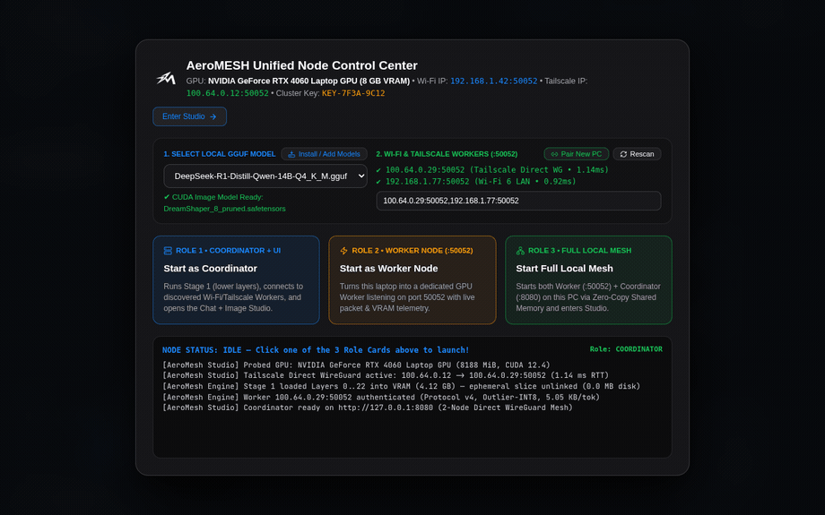
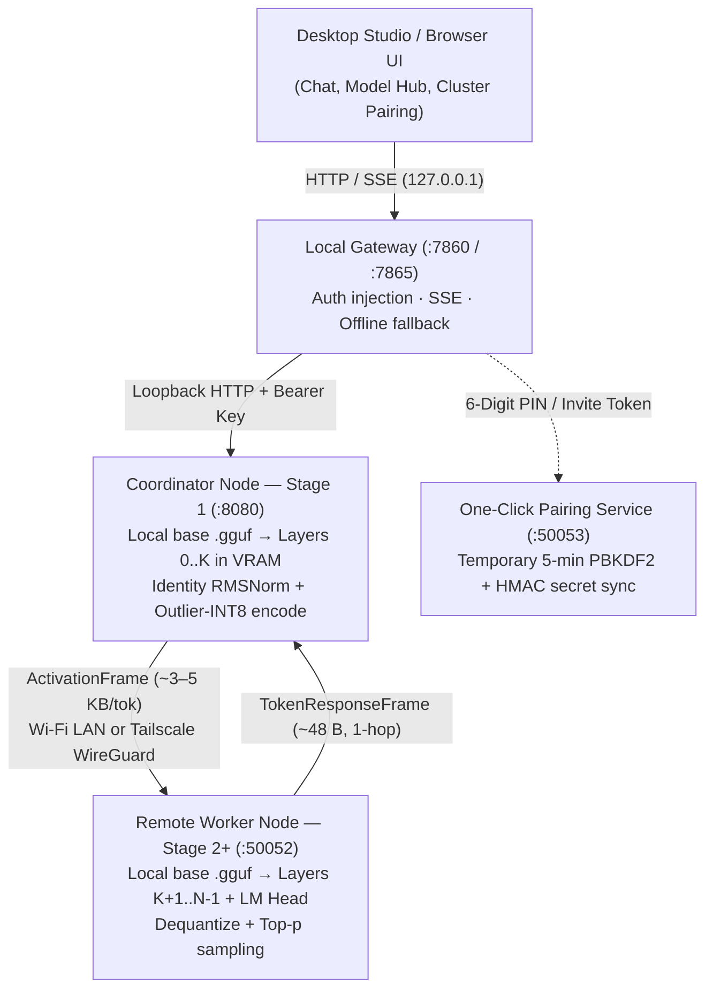
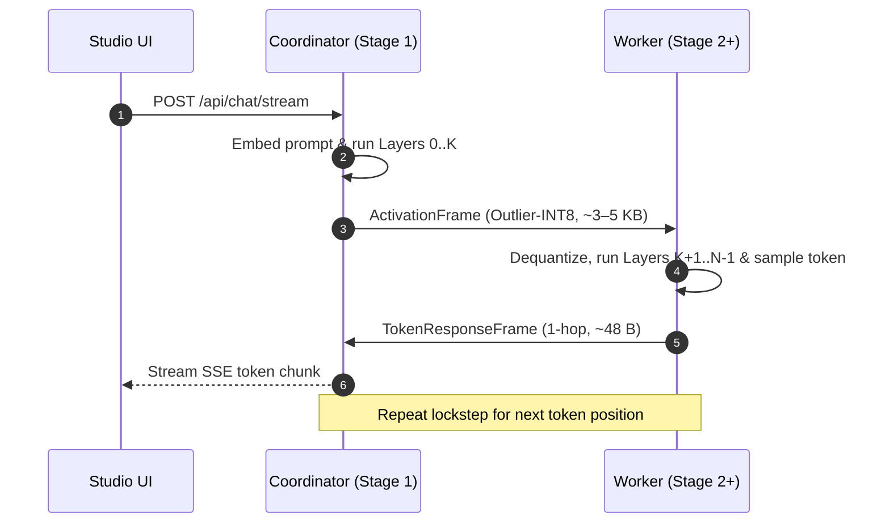
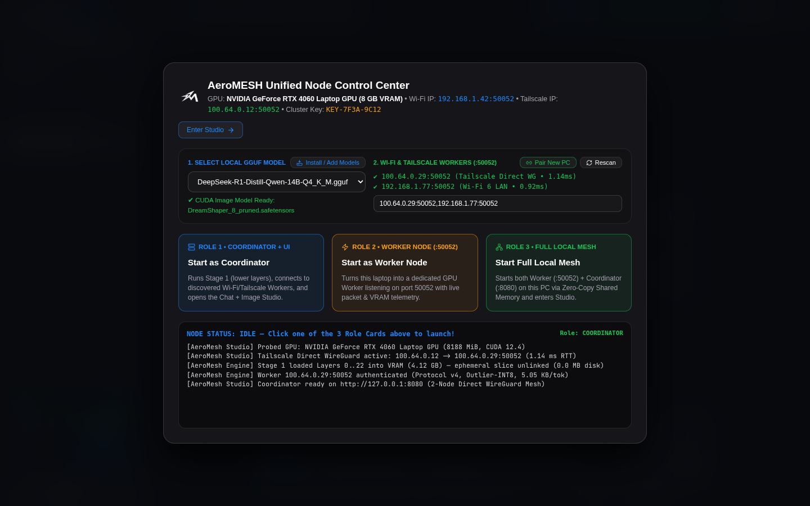
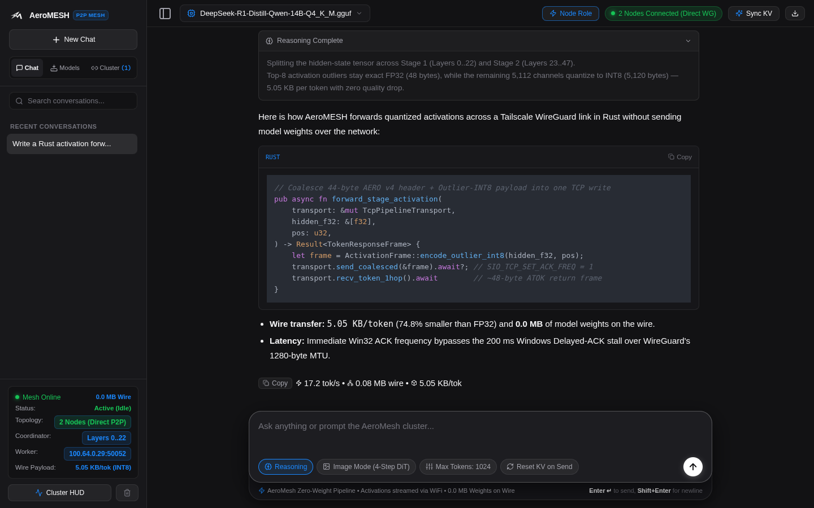
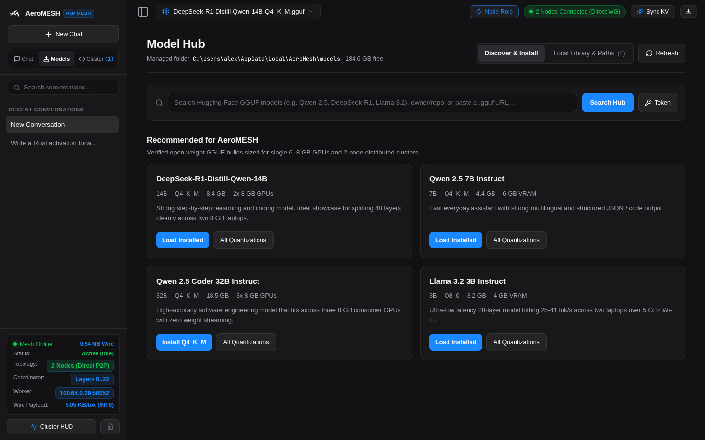
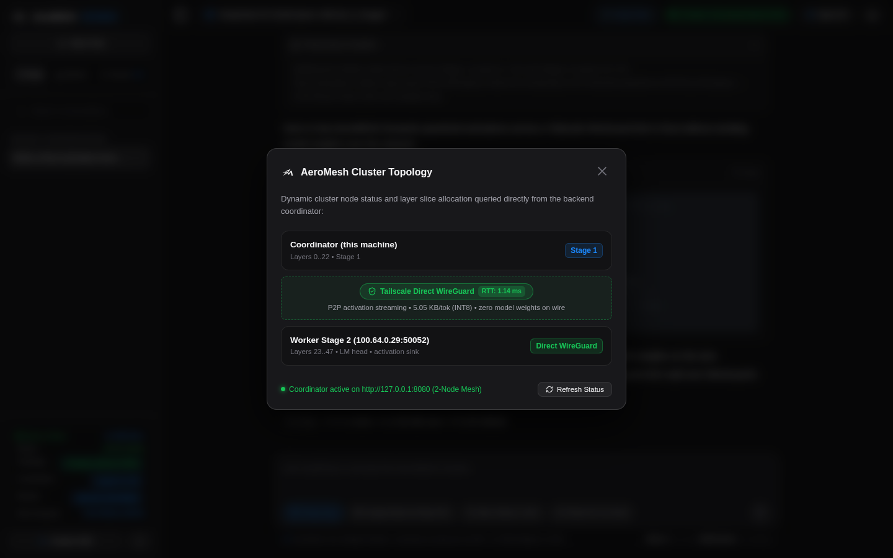
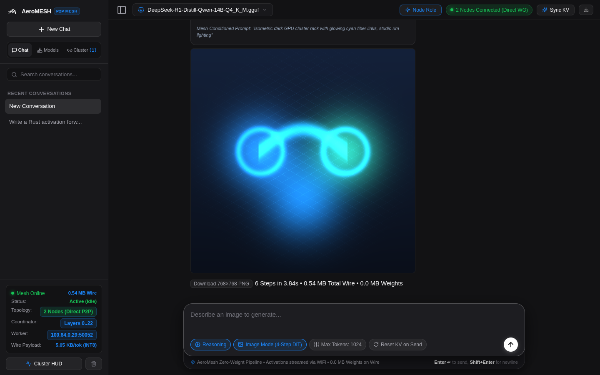

<div align="center">

  

  # AeroMESH

  **Run larger LLMs across consumer laptops and desktops over Wi-Fi or Tailscale — with 0 MB of model weights sent over the network.**

  <p align="center">
    <a href=".github/workflows/windows-release.yml"></a>
    <a href="LICENSE"></a>
    
    
    
  </p>

  <p align="center">
    <a href="#quickstart">Quickstart</a> ·
    <a href="#how-it-works">How It Works</a> ·
    <a href="#screenshots">Screenshots</a> ·
    <a href="#benchmarks">Benchmarks</a> ·
    <a href="#cli--api">CLI &amp; API</a> ·
    <a href="#documentation">Docs</a>
  </p>

  <br />

  <a href="docs/media/aeromesh-demo.mp4">
    
  </a>
  <br />
  <sub>Live UI walkthrough (Node Control Center → Streaming Chat &amp; Cluster HUD → Model Hub → 1-Click Cluster Pairing). <a href="docs/media/aeromesh-demo.mp4">Watch full HD MP4</a>.</sub>

</div>

---

## Why AeroMESH

Most gaming laptops and desktops have 6–8 GB of VRAM. A quantized 14B model needs ~9–10 GB, so running it on one machine either hits OOM or spills to system RAM and drops below 1 tok/s.

Existing distributed tools struggle on home Wi-Fi:
- **Tensor parallelism (vLLM, Megatron)** syncs inside every layer and needs datacenter interconnects (NVLink / InfiniBand).
- **Stock `llama.cpp` RPC** pushes multi-gigabyte weights over the network on startup.
- **Naive layer slicers** write permanent duplicate stage files onto your SSD.

AeroMESH splits transformer layers across your PCs while keeping weights local:

- **0 MB of model weights on the wire** — each machine keeps the same base `.gguf` locally and streams only compressed hidden-state activations (~3–5 KB/token).
- **0 MB of extra disk bloat** — slices load straight into GPU VRAM (`use_mmap = false`) and temporary stage files are deleted immediately.
- **Fast over Wi-Fi & Tailscale** — Outlier-Preserving INT8 compression cuts wire payload by ~75% without quality collapse, and Win32 `WSAIoctl` tuning eliminates the 200 ms Windows TCP Delayed-ACK stall.
- **Built-in Model Hub & 1-Click Pairing** — download GGUFs straight from Hugging Face, link existing LM Studio / Ollama folders, and sync cluster secrets across PCs with a 6-digit PIN instead of editing `.env` files by hand.
- **Standalone Windows Installer** — VS Code–style Setup Wizard (`AeroMesh-Setup-x64.exe`) that auto-detects NVIDIA/Vulkan GPUs and bundles runtimes so end users don't need Rust, Python, or the CUDA Toolkit.

---

## How It Works

### Cluster Topology



### Per-Token Inference Loop



For the full math and byte layouts (Identity RMSNorm, Outlier-INT8, Delayed-ACK bypass, SHM ring buffer, and Protocol v4 frames), see [docs/architecture/engineering-and-protocol.md](docs/architecture/engineering-and-protocol.md).

---

## Screenshots

<table>
  <tr>
    <th width="50%">Unified Node Control Center</th>
    <th width="50%">Live Streaming Inference &amp; Reasoning</th>
  </tr>
  <tr>
    <td align="center">
      <a href="docs/screenshots/01-node-control-center.png"></a><br />
      <sub>Auto GPU detection, discovered Wi-Fi/Tailscale workers, model picker, and 1-click role launch.</sub>
    </td>
    <td align="center">
      <a href="docs/screenshots/02-streaming-inference.png"></a><br />
      <sub>SSE streaming with DeepSeek-R1 reasoning foldout, syntax highlighting, and live wire telemetry.</sub>
    </td>
  </tr>
  <tr>
    <th width="50%">Model Hub &amp; Local Library</th>
    <th width="50%">One-Click Cluster Pairing &amp; Secret Sync</th>
  </tr>
  <tr>
    <td align="center">
      <a href="docs/screenshots/03-model-hub.png"></a><br />
      <sub>Curated installs, Hugging Face GGUF search, live download bars, drag-and-drop, and custom folders.</sub>
    </td>
    <td align="center">
      <a href="docs/screenshots/04-cluster-pairing.png"></a><br />
      <sub>Encrypted 6-digit PIN session on :50053, one-click invite tokens, nearby host scan, and peer compatibility.</sub>
    </td>
  </tr>
  <tr>
    <th width="50%">Cluster Topology &amp; WireGuard HUD</th>
    <th width="50%">Distributed Diffusion (DiT) Mode</th>
  </tr>
  <tr>
    <td align="center">
      <a href="docs/screenshots/05-cluster-topology.png"></a><br />
      <sub>Live Direct WireGuard link state, RTT latency, stage layer split, and wire payload rate.</sub>
    </td>
    <td align="center">
      <a href="docs/screenshots/06-distributed-diffusion.png"></a><br />
      <sub>2-node mesh prompt conditioning and stepped image synthesis with zero model weights on the wire.</sub>
    </td>
  </tr>
</table>

---

## Quickstart

### Option 1: Windows Setup Wizard (Recommended)

Download and run `AeroMesh-Setup-x64.exe` from Releases (or build it locally with `.\installer\build-installer.ps1`). No Rust, Python, or CUDA Toolkit installation needed.

1. Run the wizard — it auto-detects NVIDIA CUDA 12 / Vulkan / CPU backends, sets up firewall rules for `:50052` (worker) and `:50053` (pairing), and installs **AeroMESH Desktop Studio**.
2. Open **Model Hub** (sidebar → **Models**) to download a GGUF from Hugging Face or link your existing LM Studio / Ollama models folder.
3. To add a second PC, open **Cluster** in the sidebar:
   - On PC 1, click **Start Pairing Session** to get a 6-digit code and one-click invite token.
   - On PC 2, click **Scan Network** (or paste the invite token) and enter the 6-digit code to sync cluster keys automatically.
4. Pick a role in the **Node Control Center** (Coordinator, Worker, or Full Local Mesh) and start chatting.

### Option 2: Build from Source (Windows 10/11 x64)

Prerequisites: **Rust 1.78+**, **Git**, and optionally **Python 3.11+** (only needed for the `app.py` dev server) and **Tailscale** (for remote/NAT traversal).

```powershell
git clone https://github.com/tex1ure/AeroMESH.git
cd AeroMESH

# Checks drivers/toolchains, builds llama.cpp (b10499), fetches offline UI assets, compiles release binaries
.\setup.ps1 -CloneLlamaCpp

# Launch Desktop Studio or the interactive CLI launcher
.\launch-app.bat
# or: .\start.ps1
```

To test a full 2-stage pipeline on a single PC via zero-copy shared memory:

```powershell
.\start.ps1 all -Model "models/test.gguf"
```

---

## Benchmarks

Measured on two Windows 11 laptops (both **RTX 4060 Laptop 8 GB**, CUDA 12.4) over **5 GHz Wi-Fi 6 + Tailscale Direct WireGuard (1.14 ms RTT)**.

| Model | Split | VRAM / Node | Throughput | Wire / Token | Weights on Wire |
| :--- | :--- | :---: | :---: | :---: | :---: |
| **Llama-3.2-3B (Q8_0)** | `0..13` / `14..27` | 1.82 GB / 1.94 GB | **24.9–41.7 tok/s** | 3.05 KB | 0.0 MB |
| **DeepSeek-R1-14B (Q4_K_M)** | `0..22` / `23..47` | 4.12 GB / 4.85 GB | **15.8 tok/s** | 5.05 KB | 0.0 MB |

*DeepSeek-R1 14B OOMs or drops to ~0.3 tok/s on a single 8 GB laptop. Splitting 48 layers keeps both GPUs under 5 GB VRAM with full CUDA offload (`ngl = 999`).*

### How AeroMESH Compares

| Feature | AeroMESH | llama.cpp RPC | Exo / Petals | vLLM (TP) |
| :--- | :--- | :--- | :--- | :--- |
| **Weights sent on startup** | **0.0 MB** | Multi-GB | Multi-GB | 0.0 MB |
| **Duplicate slice files on SSD** | **0.0 MB** | 0.0 MB | High | 0.0 MB |
| **Activation size ($d=5120$)** | **5.05 KB (Outlier-INT8)** | 20.48 KB (FP32) | Varies | Multi-MB / layer |
| **Works over Wi-Fi / Tailscale** | **Yes (<1 ms Win32 ACK)** | Stalls on Windows | High latency | No (NVLink/IB) |
| **Built-in Model Hub & Pairing** | **Yes** | No | Partial | External |

See [BENCHMARKS.md](BENCHMARKS.md) for latency breakdowns and codec numbers.

---

## CLI & API

### Common CLI Commands

```powershell
# Inspect layer split & VRAM estimates
aeromesh slice-info models/DeepSeek-R1-Distill-Qwen-14B-Q4_K_M.gguf

# Verify model hash across nodes
aeromesh model-check models/DeepSeek-R1-Distill-Qwen-14B-Q4_K_M.gguf

# Check Tailscale Direct WireGuard vs DERP relay and RTT
aeromesh probe 100.64.0.29:50052

# Start a dedicated worker node (:50052)
aeromesh worker --model models/DeepSeek-R1-Distill-Qwen-14B-Q4_K_M.gguf --port 50052

# Start coordinator + OpenAI-compatible HTTP server (:8080)
aeromesh serve --model models/DeepSeek-R1-Distill-Qwen-14B-Q4_K_M.gguf --peers 100.64.0.29:50052 --port 8080
```

### OpenAI-Compatible API

```python
import openai

client = openai.OpenAI(
    base_url="http://127.0.0.1:7860/v1",
    api_key="your-aeromesh-api-key",
)

stream = client.chat.completions.create(
    model="DeepSeek-R1-Distill-Qwen-14B-Q4_K_M.gguf",
    messages=[{"role": "user", "content": "Explain Outlier-INT8 activation streaming."}],
    stream=True,
)
for chunk in stream:
    print(chunk.choices[0].delta.content or "", end="", flush=True)
```

### Running Tests

```powershell
# 66 Rust workspace tests
cargo test --workspace

# 27 Python FastAPI gateway tests (stop any running coordinator on :8080 first)
.\.venv\Scripts\pytest.exe tests/test_fastapi_gateway.py
```

---

## Documentation

| Guide | What's Inside |
| :--- | :--- |
| [Engineering & Protocol v4](docs/architecture/engineering-and-protocol.md) | Ephemeral VRAM slicing, Identity RMSNorm, Outlier-INT8 math, Delayed-ACK bypass, SHM, and binary frame layouts |
| [API Reference](API_REFERENCE.md) | Chat completions, Model Hub endpoints, Cluster Pairing endpoints, node lifecycle, and error envelopes |
| [Security](SECURITY.md) | Trust boundaries, constant-time auth, encrypted 6-digit PIN pairing crypto, and Tailscale ACLs |
| [Benchmarks](BENCHMARKS.md) | Hardware testbed, token latency breakdown, SHM vs TCP, and codec evaluations |
| [FastAPI Gateway](docs/architecture/fastapi-proxy-gateway.md) | Dual-tier proxy design, SSE streaming, offline fallback, and gateway env vars |
| [Windows Installer](installer/README.md) | Building `AeroMesh-Setup-x64.exe`, bundling CUDA/Vulkan DLLs, and code signing |
| [Limitations](LIMITATIONS.md) | Pipeline bubble trade-offs, Windows Job Object scope, and current boundaries |
| [Contributing](CONTRIBUTING.md) | Dev setup, protocol invariants, test suites, and PR checklist |
| [Changelog](CHANGELOG.md) | Release notes and version history |

---

## License

Licensed under the [Apache License 2.0](LICENSE). Built on top of [llama.cpp](https://github.com/ggerganov/llama.cpp), [Tailscale](https://tailscale.com/), [Axum](https://github.com/tokio-rs/axum), and [Tokio](https://tokio.rs/).
