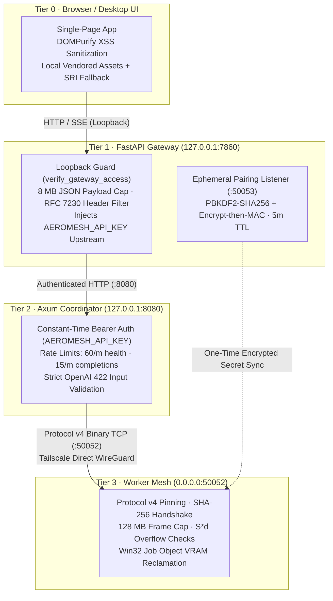

# AeroMESH Security Architecture

AeroMESH runs distributed inference across consumer laptops and desktops over home Wi-Fi or Tailscale networks. Every hop between the browser, gateway, coordinator, and remote workers enforces explicit trust boundaries and constant-time secret verification.

---

## Contents

1. [Trust Boundaries & Architecture](#1-trust-boundaries--architecture)
2. [Network Surfaces](#2-network-surfaces)
3. [Authentication by Layer](#3-authentication-by-layer)
4. [One-Click Cluster Pairing Cryptography (:50053)](#4-one-click-cluster-pairing-cryptography-50053)
5. [Constant-Time Comparisons](#5-constant-time-comparisons)
6. [Bounded Wire Deserialization (Anti-DoS)](#6-bounded-wire-deserialization-anti-dos)
7. [Secret Provisioning & Hygiene](#7-secret-provisioning--hygiene)
8. [Client-Side Security & Offline Assets](#8-client-side-security--offline-assets)
9. [Recommended Tailscale ACLs](#9-recommended-tailscale-acls)
10. [Reporting Vulnerabilities](#10-reporting-vulnerabilities)

---

## 1. Trust Boundaries & Architecture



---

## 2. Network Surfaces

| Surface | Default Bind | Protocol | Authentication | Exposure |
|:---|:---|:---|:---|:---|
| **Web Gateway** | `127.0.0.1:7860` | HTTP / SSE | Loopback allowlist or `AEROMESH_GATEWAY_API_KEY` | Loopback only |
| **Coordinator API** | `127.0.0.1:8080` | HTTP / JSON | Constant-time Bearer (`AEROMESH_API_KEY`) | Loopback or private Tailnet |
| **Worker Mesh** | `0.0.0.0:50052` | Binary TCP (`AERO`) | SHA-256 handshake (`AEROMESH_WORKER_SECRET`) | LAN / Tailscale ACLs only |
| **Pairing Listener** | `0.0.0.0:50053` *(off by default)* | Encrypted JSON over TCP | 6-digit one-time PIN (PBKDF2 + HMAC-SHA256) | Ephemeral (max 5 min while hosting) |

---

## 3. Authentication by Layer

### Web Gateway (`app.py` :7860)
- **Loopback enforcement (`verify_gateway_access`):** Requests from `127.0.0.1`, `localhost`, or `::1` are permitted locally. Any non-loopback caller must supply `Authorization: Bearer <AEROMESH_GATEWAY_API_KEY>`; if unset, external callers receive `401 Unauthorized`.
- **Credential ownership:** Browser JavaScript never reads `AEROMESH_API_KEY`. Any incoming `Authorization` header is stripped before the gateway injects its internal Bearer secret on loopback calls to `:8080`.
- **Payload limits:** JSON proxy requests are capped at `MAX_REQUEST_BYTES = 8_388_608` (8 MB) before buffering.

### Coordinator Engine (`crates/aeromesh-engine/src/server.rs` :8080)
- **Constant-time Bearer check:** All routes except `GET /health` verify `AEROMESH_API_KEY` using `constant_time_eq_str`. If the key is missing from the environment, protected routes fail closed.
- **Rate limiting:** Separate token buckets cap `/health` at 60 req/min and completions at 15 req/min, returning OpenAI-format `429` responses.

### Worker P2P Mesh (`crates/aeromesh-core/src/activation.rs` :50052)
- **Protocol pinning:** Connections below Protocol Version 4 are rejected immediately.
- **Mutual handshake:** Nodes hash `AEROMESH_WORKER_SECRET` with SHA-256 into a 32-byte token verified in constant time. Mismatched handshakes drop the TCP socket immediately.

---

## 4. One-Click Cluster Pairing Cryptography (:50053)

To eliminate manual `.env` copy-pasting between machines, the **Cluster** tab supports one-click secret sync over Wi-Fi or Tailscale:

1. **Off by default:** TCP port `50053` is closed unless the user explicitly clicks **Start Pairing Session**.
2. **Short TTL & brute-force lockout:** Each session generates a fresh 6-digit PIN (`secrets.randbelow`), expires automatically after **5 minutes**, and locks out after **5 failed attempts**.
3. **Key derivation:** A 16-byte random salt and the 6-digit PIN derive independent encryption and MAC keys via **PBKDF2-HMAC-SHA256** (200,000 iterations).
4. **Encrypt-then-MAC:** The cluster payload (`AEROMESH_WORKER_SECRET`, node metadata, and local model list) is encrypted with a SHA-256 CTR-mode keystream and authenticated with **HMAC-SHA256** over `(salt || nonce || ciphertext)`. Decryption verifies the MAC with `hmac.compare_digest` before touching plaintext.
5. **Key rotation:** Clicking **Rotate Cluster Key** (`POST /api/cluster/pair/rotate`) generates a fresh 256-bit `AEROMESH_WORKER_SECRET`, updates `.env`, and flags previously paired nodes for re-pairing.

---

## 5. Constant-Time Comparisons

All API key and worker handshake comparisons avoid early-exit timing leaks:

```rust
pub fn constant_time_eq_str(a: &str, b: &str) -> bool {
    let hash_a = sha2::Sha256::digest(a.as_bytes());
    let hash_b = sha2::Sha256::digest(b.as_bytes());
    constant_time_eq_32(&hash_a.into(), &hash_b.into())
}

pub fn constant_time_eq_32(a: &[u8; 32], b: &[u8; 32]) -> bool {
    let mut diff = 0u8;
    for (x, y) in a.iter().zip(b.iter()) {
        diff |= x ^ y;
    }
    diff == 0
}
```

---

## 6. Bounded Wire Deserialization (Anti-DoS)

Incoming binary frames on `:50052` are validated before any heap allocation:
1. **Payload cap:** `MAX_FRAME_PAYLOAD_BYTES = 134_217_728` (128 MB).
2. **Tensor bounds:** Sequence length $S \le 131{,}072$, hidden dimension $d \le 65{,}536$.
3. **Exact size invariant:** `header.payload_bytes` must equal the exact byte size implied by $S$, $d$, and `dtype` using checked arithmetic. Mismatches or overflows drop the frame immediately.

---

## 7. Secret Provisioning & Hygiene

On first run, `start.ps1` and the Windows installer generate cryptographically secure 256-bit random keys for `AEROMESH_API_KEY` and `AEROMESH_WORKER_SECRET` via `System.Security.Cryptography.RandomNumberGenerator` (or Python's `secrets.token_hex(32)` in the gateway).

`.env`, `.env.*`, and temporary `.aeromesh_ephemeral_*` slice files are excluded in `.gitignore`.

---

## 8. Client-Side Security & Offline Assets

- **DOMPurify sanitization:** Markdown and `<think>` reasoning blocks rendered in the browser pass through DOMPurify before DOM insertion.
- **Offline-first vendored libraries:** Frontend libraries (Lucide, Marked, DOMPurify, Highlight.js, KaTeX) are bundled locally under `static/vendor/` so the UI works offline without external requests; optional CDN fallbacks are pinned with SHA-384/SHA-512 Subresource Integrity (SRI) hashes.
- **Strict CORS:** The Axum coordinator restricts CORS to the local gateway origin (`http://127.0.0.1:7860`).

---

## 9. Recommended Tailscale ACLs

When running across machines on a Tailscale tailnet, restrict port `50052` to tagged coordinator and worker hosts:

```json
{
  "acls": [
    {
      "action": "accept",
      "src": ["tag:coordinator"],
      "dst": ["tag:worker:50052"]
    }
  ],
  "tagOwners": {
    "tag:coordinator": ["autogroup:admin"],
    "tag:worker": ["autogroup:admin"]
  }
}
```

---

## 10. Reporting Vulnerabilities

If you find a security issue or auth bypass, please do not open a public GitHub issue. Contact the maintainers privately with reproduction steps and environment details; we aim to acknowledge reports within 48 hours.
