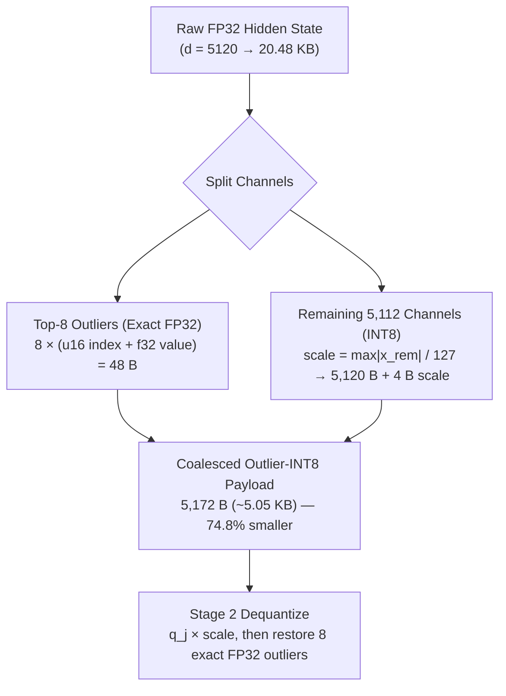

# AeroMESH Engineering & Protocol v4 Reference

This document covers the low-level design details behind AeroMESH's zero-weight distributed pipeline: ephemeral GGUF stage loading, Outlier-INT8 activation compression, Windows TCP socket tuning, shared-memory transport, and the Protocol v4 wire format.

For quickstart instructions and high-level usage, see [README.md](../../README.md).

---

## 1. Ephemeral VRAM Loading & Identity RMSNorm

Splitting a Transformer model across two `llama.cpp` processes creates two problems if done naively: double normalization at the stage boundary and duplicated `.gguf` files eating up SSD space.

### Fixing Double Normalization

Modern Transformer architectures (Llama 3, Qwen 2.5, DeepSeek-R1) finish with an RMSNorm (`output_norm.weight`) right before the LM head (`output.weight`):

$$\mathbf{x}_{\text{final}} = \text{RMSNorm}(\mathbf{x}_L, \mathbf{w}_{\text{norm}}) = \frac{\mathbf{x}_L}{\sqrt{\frac{1}{d} \sum_{i=1}^d x_{L, i}^2 + \epsilon}} \odot \mathbf{w}_{\text{norm}}, \qquad \mathbf{z} = \mathbf{x}_{\text{final}} \cdot \mathbf{W}_{\text{head}}$$

If Stage 1 runs as a standard `llama.cpp` model, it applies the trained `output_norm.weight` to the intermediate hidden state $\mathbf{x}_K$ before returning activations. Stage 2 then receives a distorted, pre-normalized residual stream, which degrades attention scores and triggers repetition loops.

`crates/aeromesh-engine/src/gguf_slicer.rs` avoids this during slicing:

- **Identity RMSNorm on non-terminal stages**: Replaces `output_norm.weight` with $\mathbf{w}_{\text{identity}} = [1.0, 1.0, \dots, 1.0]$ so the intermediate residual stream passes through intact.
- **LM head stripping**: Drops `output.weight` and `output.bias` from non-terminal stages, saving several hundred MB of VRAM on the Coordinator.
- **Contiguous block re-indexing**: On Worker stages (Stage 2+), re-indexes assigned layers starting from `blk.0.*` with 32-byte tensor alignment while keeping the real `output_norm.weight` and `output.weight` on the final stage.
- **0.0 MB persistent disk overhead (`InPlaceStageGuard`)**: Writes temporary `.aeromesh_ephemeral_*` stage slices, loads them directly into GPU VRAM with `use_mmap = false`, and immediately unlinks and deletes the temporary file once VRAM initialization completes.

---

## 2. Outlier-Preserving INT8 Activation Codec

Models like DeepSeek-R1, Qwen 2.5, and Llama 3 produce large activation outliers in a handful of channels ($|x_j| > 50.0$) while most channels sit within $[-1.5, 1.5]$. Standard per-row INT8 scaling ($\text{scale} = \max_j |x_j| / 127$) gets stretched by those outliers, collapsing normal channels down to `0` or `±1` and breaking output coherence.

AeroMESH's `Int8PerRow` codec (`crates/aeromesh-core/src/activation.rs`) separates outliers before quantization for hidden dimensions $d \ge 256$:

### Wire Layout (per row, $d \ge 256$)

1. `[4 bytes]` — `scale` (`f32` little-endian), computed only over non-outlier channels.
2. `[d bytes]` — quantized `i8` values: $q_j = \text{clamp}(\lfloor x_j / \text{scale} + 0.5 \rfloor, -127, 127)$.
3. `[48 bytes]` — Top-8 outlier entries as `(u16 index, f32 value)` pairs.

| Format | Tag | Bytes / Element | Size ($d=3072$) | Size ($d=5120$) | Bandwidth Saved |
| :--- | :---: | :---: | :---: | :---: | :---: |
| **Raw FP32** | `RawF32` | 4 B | 12,288 B | 20,480 B | Baseline |
| **FP16 / BF16** | `Fp16` / `Bf16` | 2 B | 6,144 B | 10,240 B | 50.0% |
| **FP8 (E4M3)** | `Fp8E4M3` | 1 B | 3,072 B | 5,120 B | 75.0% |
| **Outlier-INT8** | `Int8PerRow` | 1 B + 48 B outliers | **3,124 B (3.05 KB)** | **5,172 B (5.05 KB)** | **~74.8%** |

---

## 3. Windows TCP Delayed-ACK Bypass

Tailscale WireGuard uses a 1280-byte MTU (1240-byte TCP MSS). A 14B Outlier-INT8 activation frame is $5172 + 44 = 5216$ bytes, which splits into $\lceil 5216 / 1240 \rceil = 5$ TCP segments.

Because `5` is odd, Windows' default `TcpAckFrequency = 2` ACKs segments 1–2 and 3–4 right away, then stalls up to **200 ms** waiting for a 6th segment that never comes. That single timer caps distributed generation to ~5 tok/s.

`crates/aeromesh-core/src/transport.rs` applies Win32 `WSAIoctl` tuning to every coordinator and worker socket:

- `SIO_TCP_SET_ACK_FREQUENCY = 1` (`0x98000017`) — ACK every incoming segment immediately.
- `SIO_LOOPBACK_FAST_PATH = 1` (`0x98000010`) — fast-path loopback routing on Windows.
- `TCP_NODELAY = true` — disables Nagle buffering.
- `512 KB` `SO_SNDBUF` / `SO_RCVBUF` + coalesced `BytesMut` writes (44-byte header and payload sent in a single syscall).

In testing across two RTX 4060 laptops over 5 GHz Wi-Fi + Tailscale WireGuard, this lifts generation throughput from **2–5 tok/s to 15–41 tok/s**.

---

## 4. Intra-Host Shared Memory (SHM) Transport

When running a single-machine local mesh (`.\start.ps1 all` or Role 3 in the Desktop Studio), `crates/aeromesh-core/src/shm.rs` bypasses TCP with a lock-free SPSC ring buffer backed by `memmap2`:

- 64-byte padded `AtomicUsize` head/tail pointers to avoid false sharing.
- 64-iteration cooperative `tokio::task::yield_now()` spin loop before falling back to microsecond sleep, keeping local handoffs under 100 microseconds.

---

## 5. Tailscale Probing, Job Objects & Safety Checks

- **Direct WireGuard Detection (`tailscale.rs`)**: Parses `tailscale status --json` and probes worker sockets (`aeromesh probe <ip>:50052`). Flags DERP relay connections (which add 80–300 ms) and gates automatic admission on direct links with RTT $\le 150\text{ ms}$.
- **Win32 Job Objects (`job_object.rs`)**: Spawns native child processes inside a `SafeProcessJob` with `JOB_OBJECT_LIMIT_KILL_ON_JOB_CLOSE`. If the coordinator exits, crashes, or gets killed in Task Manager, Windows immediately terminates child processes and frees locked CUDA VRAM.
- **RPC Cache Pre-Priming (`cache_prime.rs`)**: For optional fallback `--mode rpc`, `aeromesh prime-cache` hashes local `.gguf` tensors (>10 MB) with 64-bit FNV-1a (`0xcbf29ce484222325`) and populates `%LOCALAPPDATA%\llama.cpp\rpc\<hash>` directly from NVMe.
- **Activation Watchdog**: `aeromesh_core::inspect_activations` traps `NaN`/`Inf` values, warns on near-zero dead tensors ($\|A\|_F < 10^{-7}$), and rejects requests exceeding `n_ctx - max_tokens` with HTTP `422` before allocating GPU buffers.

---

## 6. Binary Wire Protocol Specification (Protocol v4)

All multi-byte integer fields in Protocol v4 frames use **Big-Endian** byte order.

### ActivationHeader (44 Bytes Fixed)

Sent from upstream to downstream stage ahead of the raw or quantized activation payload.

| Offset | Field | Type | Description |
| :---: | :--- | :---: | :--- |
| `0..4` | `magic` | `[u8; 4]` | `b"AERO"` (`0x41 0x45 0x52 0x4F`) |
| `4..6` | `version` | `u16` | Protocol version (`4`; frames `< 4` are rejected) |
| `6..14` | `session_id` | `u64` | Monotonic conversation session ID |
| `14..22` | `sequence_id` | `u64` | Monotonic step counter |
| `22..26` | `sequence_length` | `u32` | Token count $S$ ($S=1$ decode, $S>1$ prefill; max `131,072`) |
| `26..30` | `token_position` | `u32` | Global RoPE / KV-cache sequence position |
| `30..31` | `stage_index` | `u8` | 0-indexed sender stage |
| `31..32` | `total_stages` | `u8` | Total pipeline stages ($\ge 2$) |
| `32..34` | `layer_index` | `u16` | Split layer boundary (e.g., `13`, `22`) |
| `34..38` | `hidden_dim` | `u32` | Model hidden dimension $d_{\text{model}}$ |
| `38..39` | `dtype` | `u8` | `0`=FP32, `1`=FP16, `2`=BF16, `3`=Outlier-INT8, `4`=FP8 |
| `39..40` | `flags` | `u8` | Bitmask: `0x01`=Clear KV, `0x02`=Prefill, `0x04`=EOS |
| `40..44` | `payload_bytes` | `u32` | Exact payload byte length (hard cap: `128 MB`) |

### TokenResponseFrame (35 Bytes Fixed Header + UTF-8 Payload)

Returned directly from the terminal stage to the Coordinator in 1 hop.

| Offset | Field | Type | Description |
| :---: | :--- | :---: | :--- |
| `0..4` | `magic` | `[u8; 4]` | `b"ATOK"` (`0x41 0x54 0x4F 0x4B`) |
| `4..6` | `version` | `u16` | Protocol version (`4`) |
| `6..14` | `session_id` | `u64` | Matching session ID |
| `14..22` | `sequence_id` | `u64` | Matching sequence ID |
| `22..26` | `token_id` | `i32` | Sampled vocabulary token ID |
| `26..27` | `is_eos` | `u8` | `1` if end-of-sequence, `0` otherwise |
| `27..31` | `eval_time_ms` | `f32` | Terminal worker GPU eval time (ms) |
| `31..35` | `text_len` | `u32` | Byte length of UTF-8 token text |
| `35..end` | `token_text` | `[u8]` | Decoded UTF-8 token fragment |

### Mutual Handshake (`AHSK` / `AHSR`)

Before streaming activations:
1. Coordinator sends `HandshakeRequest` (`b"AHSK"`) with model architecture, total layers, hidden dim, and a SHA-256 auth token derived from `AEROMESH_WORKER_SECRET`.
2. Worker validates the token in constant time (`constant_time_eq_32`), verifies its local GGUF slice matches the requested layer range, and replies with `HandshakeResponse` (`b"AHSR"`).
