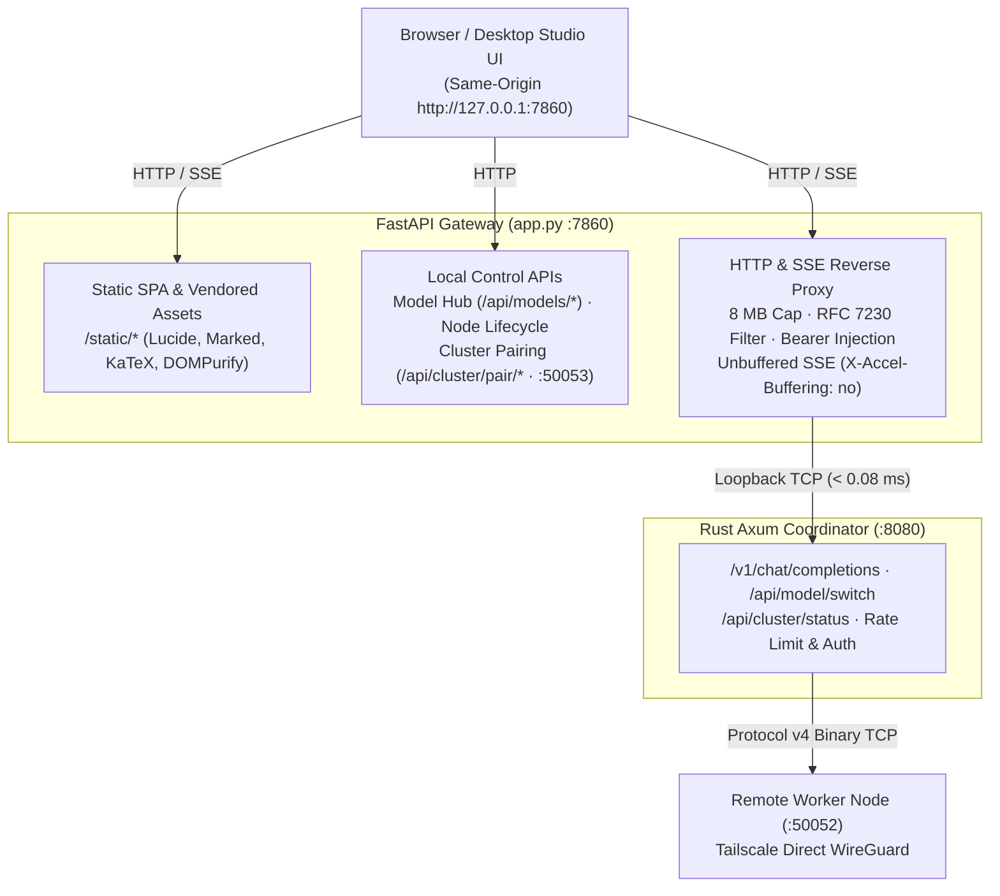

# FastAPI Gateway Architecture

`app.py` runs on `http://127.0.0.1:7860` as the browser-facing layer in front of the Rust Axum coordinator (`127.0.0.1:8080`). It serves the Studio UI, injects backend Bearer tokens, streams SSE tokens without buffering, and hosts the local **Model Hub** and **One-Click Cluster Pairing** APIs.

---

## 1. Request Flow



---

## 2. Why Keep a Localhost Gateway?

| Concern | Direct Axum Only | Dual-Tier Gateway (AeroMESH) |
|:---|:---|:---|
| **UI iteration** | Rebuilds Rust crates for routing/UI helpers. | Instant Python + vanilla JS iteration. |
| **Credential isolation** | Browser JS would need `AEROMESH_API_KEY`. | Gateway holds the secret and injects `Authorization: Bearer` on loopback calls. |
| **Offline UX** | Browser gets `ERR_CONNECTION_REFUSED` when engine is stopped. | UI stays online, scans local/linked models, and lets users start/stop nodes or pair clusters. |
| **Local desktop tooling** | Native dialogs, HF downloads, and `:50053` pairing would bloat the inference binary. | Handled cleanly in `app.py` with async workers. |
| **Latency cost** | 0 ms | `< 0.08 ms` on loopback vs 40–100 ms/token GPU compute. |

---

## 3. Environment Variables

| Variable | Default | Fallbacks | Purpose |
|:---|:---|:---|:---|
| `AEROMESH_UI_HOST` | `127.0.0.1` | `HOST` | Bind interface (defaults strictly to loopback). |
| `AEROMESH_UI_PORT` | `7860` | `AEROMESH_PORT`, `PORT` | Gateway TCP port. |
| `AEROMESH_BACKEND_URL` | `http://127.0.0.1:8080` | `AEROMESH_ENDPOINT` | Upstream Axum coordinator URL. |
| `AEROMESH_API_KEY` | `""` | — | Injected as `Authorization: Bearer` toward `:8080`. |
| `AEROMESH_GATEWAY_API_KEY` | `""` | — | Required for non-loopback clients when bound beyond `127.0.0.1`. |
| `AEROMESH_MAX_REQUEST_BYTES` | `8388608` (8 MB) | — | JSON proxy body limit. |

If `AEROMESH_UI_HOST` is set outside loopback, non-loopback requests fail closed with `401` unless `AEROMESH_GATEWAY_API_KEY` matches.

---

## 4. Route Map

| Method | Gateway Route | Target | Role |
|:---|:---|:---|:---|
| `GET` | `/health` | Local | Gateway liveness probe |
| `GET` | `/ready` | `/health` (`:8080`) | End-to-end readiness (200 ok / 503 unreachable) |
| `GET` | `/`, `/static/*` | Local | Studio SPA and offline vendored libraries |
| `GET` | `/v1/models` | `/v1/models` | Active model list; falls back to local/linked disk scan when offline |
| `POST` | `/api/model/switch`, `/v1/models/load` | `/api/model/switch` | Transactional cluster model switch |
| `GET` | `/api/cluster/status` | `/api/cluster/status` | Live topology & wire metrics; structured offline fallback |
| `GET` | `/api/cluster/discover` | Local | Scans Tailnet & LAN for `:50052` workers |
| `GET/POST` | `/api/cluster/pair/*` | Local (`:50053`) | One-Click Cluster Pairing (status, start, stop, discover, join, rotate, remove) |
| `GET/POST` | `/api/models/*` | Local | Model Hub (library, custom folders, import-path, browse, upload, delete, HF search/files/download) |
| `GET/POST` | `/api/node/*` | Local | Local node state, start, and stop |
| `POST` | `/v1/chat/completions`, `/api/chat`, `/api/chat/stream` | `/v1/chat/completions` | Chat completions and unbuffered SSE token streaming |
| `POST` | `/api/chat/abort` | `/api/chat/abort` | Cancels active generation |
| `POST` | `/v1/images/generations`, `/api/image/stream` | Local | Mesh-conditioned DiT / Stable Diffusion pipeline |
| `*` | `/api/{path}`, `/v1/{path}` | Same path on `:8080` | Catch-all authenticated proxy |

---

## 5. Streaming & Teardown Semantics

- **Zero-buffer SSE:** Streams chunks via `aiter_raw()` with `Cache-Control: no-cache` and `X-Accel-Buffering: no`.
- **Infinite read timeout:** Shared `httpx.AsyncClient` uses `httpx.Timeout(connect=5.0, read=None, write=30.0, pool=10.0)` so long reasoning traces do not time out.
- **Immediate abort cleanup:** Stopping generation triggers `POST /api/chat/abort` and closes the upstream `httpx` stream via `BackgroundTask(backend_response.aclose)`.
- **Hop-by-hop stripping:** Removes `Connection`, `Keep-Alive`, `Transfer-Encoding`, `Upgrade`, `Host`, and `Content-Length` per RFC 7230.

---

## 6. Automated Tests

Validated by 27 parametrized pytest cases in [tests/test_fastapi_gateway.py](../../tests/test_fastapi_gateway.py):

```powershell
.\.venv\Scripts\pytest.exe tests/test_fastapi_gateway.py -v
```
